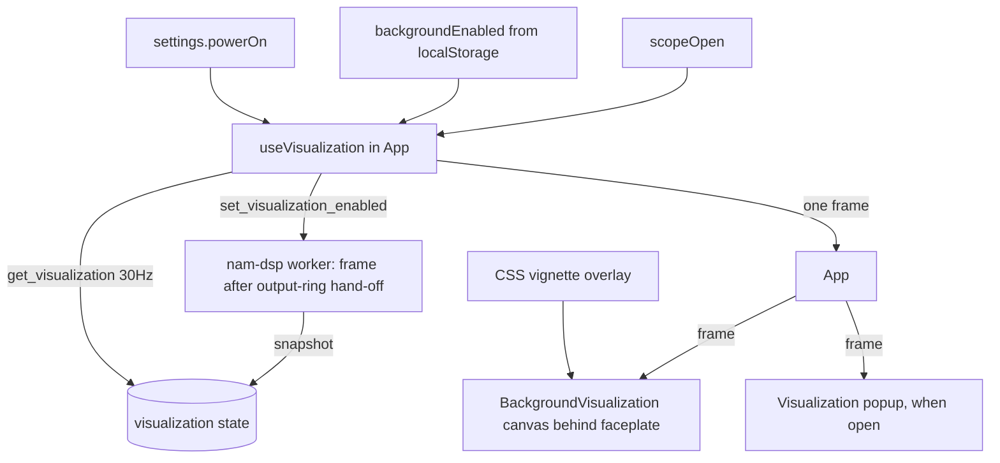

# Background Sound Visualization for NAMpli

# Requirements

### Overview
Turn the sound visualization into an **ambient background** of the main app window instead of only
showing it in the Scope popup. A full-window canvas sits behind the amp faceplate and paints a muted
spectrum field and waveform trace driven by the same audio data the Scope already uses. The faceplate,
title bar and status bar stay fully readable; the visualization is atmosphere, not a control.

The backend built for the Scope plan is reused unchanged (`get_visualization` /
`set_visualization_enabled`). The work is a frontend refactor: one shared polling loop at `App` level,
a new background canvas component, and a global toggle in Settings.

### Goals
- Show the played sound behind the amp panel whenever the amp is powered on, without opening a popup.
- Keep it subtle: low-opacity, dark/gold palette, with the centre behind the faceplate dimmed so knobs
  and labels keep their contrast.
- Reuse the existing visualization snapshot — no second polling loop, no conflicting enable flags,
  no new Tauri commands, no audio-pipeline changes.
- Let the user switch it off (and tune its intensity) from Settings for low-latency / low-CPU sessions.
- Respect `prefers-reduced-motion` and pause work when the window is hidden.

### In Scope
- **Frontend**: a `BackgroundVisualization` canvas, centralized visualization state in `App`, a
  Settings toggle + intensity control (locally persisted), stacking-context fixes in `App.css`.
- **Refactor**: `Visualization` (popup) becomes a pure presentational component receiving the frame
  from `App`.
- **Docs**: README section describing the background and its Settings controls.

### Out of Scope
- Backend/DSP changes: no new FFT, no new command, no change to analysis cadence in v1 (see Open
  decisions for a low-detail refinement if xruns appear).
- A spectrogram waterfall, reactive panel colours, per-knob colour mapping, or canvas export.
- Preset/rig-state integration — the toggle and intensity are global UI settings, not preset data,
  exactly like the existing device/latency settings.
- Window resizing or layout changes (the window is fixed at 1200×650, `resizable: false`).

### UX behaviour
- With power on and the setting enabled, a spectrum glow rises from the bottom of the window and a
  faint waveform runs across the middle. With no signal (or power off) it fades to a flat, static
  idle state.
- The faceplate and text are never obscured: a CSS vignette/gradient layer sits above the canvas and
  below `.app-content`, darkening the centre.
- The Scope popup still opens from the title bar as the detailed view; while it is open the background
  keeps running from the same frames (no double polling).
- Settings → **Visualization** has:
  - `Background visualization` checkbox (default **on**).
  - `Intensity` slider (0–100%, default ~35%), disabled when the checkbox is off.
  - Values are stored in `localStorage` and restored on startup.
- Turning the toggle off immediately clears the canvas and disables the DSP work through the existing
  `set_visualization_enabled(false)` path.

# Technical Design

### Current Implementation
- **`src-tauri/src/audio_engine.rs:595–616`** — the DSP worker publishes a visualization frame after
  the output-ring hand-off; `set_visualization_enabled` gates the work with an `AtomicBool`. This is
  already suitable for continuous background use. **No Rust changes are needed.**
- **`src/tauri.ts`** — `getVisualization(): Promise<VisualizationFrame | null>` and
  `setVisualizationEnabled(enabled)` already exist.
- **`src/hooks/useVisualization.ts`** — currently called only by the popup; its effect sends the
  enable flag and polls every 33 ms. Calling it in *two* mounted components would toggle the flag
  twice and double IPC, so it must move up to `App`.
- **`src/components/Visualization.tsx`** — currently owns the hook (`const frame = useVisualization(true, powered)`)
  and draws two canvases; it must become a pure `frame` + `powered` consumer.
- **`src/App.tsx:34–36, 249–253, 276–…`** — `showTuner` / `showVisualization` state, `TitleBar`
  props, and the two mutually exclusive popups: the natural place to own the shared frame.
- **`src/components/SettingsPanel.tsx:14–16, 34–42, 173–259`** — props, local React state and the
  `settings-section` markup where the new controls belong. Settings are local state today (no
  persistence layer), so `localStorage` is the lightest fit.
- **`src/App.css:1–20`** — `.app` and `.app-content` are current flow-level containers with no stacking
  context; a canvas child needs explicit `position` / `z-index` ordering.
- **`src/components/TitleBar.css:14–18`** — title bar is `fixed` at `z-index: 1000`; status bar is 150
  and popups are 300–600, all safely above a background at z-index 0.
- **`src/index.css:7–34, 58–66`** — theme variables (`--gold`, `--bg-app`, `--gold-line`, …) and an
  existing `prefers-reduced-motion` media query.
- **`src-tauri/tauri.conf.json:13–21`** — fixed 1200×650, non-resizable window: canvas dimensions are
  stable, only DPR needs handling.
- **`.junie/plans/sound-visualization.md`** — the design this builds on.

### Key Decisions
1. **One hook, one poll loop, one enable flag.** `App` calls `useVisualization(active, …)` where
   `active = powered && (backgroundEnabled || scopeOpen)`, then passes the frame to both the
   background and the popup. This prevents the popup's unmount cleanup from disabling the background
   and avoids two 30 Hz IPC streams.
2. **Backend unchanged.** The existing snapshot and enable command are sufficient. Analysis keeps
   running at ~47 Hz while powered with the setting on; if that ever shows up as xruns, a low-detail
   cadence is a documented refinement (Open decisions), not a prerequisite.
3. **Still zero added audio latency.** The tap remains after the output-ring hand-off; background
   rendering happens entirely in the webview. The only new cost is continuous (small) DSP work and
   canvas painting, both bounded by the Settings toggle.
4. **Ambient, not dominant.** The canvas uses low alpha (~0.10–0.2), a bottom-anchored gradient and a
   centre vignette. No `shadowBlur` on the full-window canvas; gradients are cached per size. Intensity
   multiplies the alpha rather than changing data or geometry.
5. **Cheap redraws.** Draw only when a new frame arrives (≤30 Hz), inside a single
   `requestAnimationFrame`. Cap DPR at 1.5 to bound pixel work on HiDPI displays. `pointer-events: none`
   so the canvas never eats clicks.
6. **Explicit stacking context.** `.app { position: relative; isolation: isolate; }`, background canvas
   `position: absolute; inset: 0; z-index: 0`, `.app-content { position: relative; z-index: 1; }`. The
   vignette overlay sits at z-index 0 above the canvas via DOM order (or z-index 0 with a later
   sibling); all existing dialogs/status layers already use ≥150.
7. **Global local settings, not presets.** Toggle/intensity live in `localStorage` under a single key,
   mirroring how device and latency settings are global. No rig-state field, no `RigSnapshot` change
   and no dirty-tracking impact.
8. **Keep the Scope popup.** It is the detailed instrument (frequency labels, level meter, clip
   indicator, zero-crossing trigger); the background is decorative and deliberately lower fidelity.
9. **Pause when idle.** Stop polling (and let the enable flag go false) when the window is hidden or
   power is off. Full Tauri window-event handling is optional for v1; `document.hidden` plus the power
   gate covers the common cases.

### Data flow

### Proposed Changes

**Frontend — `src/hooks/useVisualization.ts`**
- Rename the first parameter from `open` to `enabled` (or document that callers pass the combined
  `powered && (background || scope)` condition). Behaviour is otherwise unchanged; keep the 33 ms
  interval, `cancelled` guard, stale-frame protection and disable-on-cleanup.
- Optional: listen for `visibilitychange` and treat a hidden document as inactive so polling and DSP
  stop while the window is not being viewed. Add `document.hidden` to the effect dependencies.

**Frontend — `src/components/Visualization.tsx` / `.css`**
- Replace `const frame = useVisualization(true, powered)` with a `frame: VisualizationFrame | null`
  prop; remove the hook import. Keep `powered` for the idle hint. `App` becomes the sole hook caller.
- CSS unchanged apart from any class names needed for the popup wrapper.

**Frontend — `src/components/BackgroundVisualization.tsx` (new) + `.css`**
- Props: `{ frame: VisualizationFrame | null; intensity: number }`.
- A single full-window `<canvas className="background-visualization">` plus a
  `
` sibling.
- `surface()` helper (reuse the DPR logic from `Visualization.tsx`, capped at 1.5) resizes the canvas
  only when its client rect changes. Cache the bottom-up gold gradient per size; multiply its alpha
  by `intensity`.
- Draw:
  - **Spectrum**: 64 bars stretched across the full width, anchored to the bottom, height scaled to
    ~35% of the window, filled with the cached gradient at low alpha. Mirror faintly at the top for
    symmetry if it reads well.
  - **Waveform**: a single low-alpha horizontal trace centred vertically, using the existing
    rising-edge trigger idea from the popup, spanning the window width.
  - **Idle**: when `frame === null`, clear to transparent and draw a flat centre line at minimal
    alpha (or nothing at all — decided during implementation).
- Wrap drawing in `useEffect(..., [frame, intensity])` with one `requestAnimationFrame` and cancel it
  on cleanup. Never call `setState` from the effect.
- CSS: `position: absolute; inset: 0; width/height: 100%; z-index: 0; pointer-events: none;` the
  vignette uses a radial-gradient (transparent centre → `var(--bg-app)` edges) so the faceplate stays
  legible. Honour `prefers-reduced-motion` by rendering a single static frame.

**Frontend — `src/App.tsx` / `src/App.css`**
- Add local state `backgroundEnabled` (default `true`) and `backgroundIntensity` (default `35`),
  initialized from `localStorage` (guarded against corrupt/absent values). Persist on change with a
  small helper (e.g. `useBackgroundSettings` hook or two effects).
- Call `useVisualization(backgroundEnabled || showVisualization, settings.powerOn)` once here — the
  hook already ANDs both arguments, so no separate `visualizationActive` variable is needed. Pass the
  returned frame to
  `<BackgroundVisualization frame={frame} intensity={...} />` (rendered as the first child of `.app`)
  and to the Scope popup's `<Visualization frame={frame} powered={...} />`.
- Pass `backgroundEnabled`, `backgroundIntensity` and their setters to `<SettingsPanel>`.
- `App.css`: create the stacking context as described in Key Decision 6; ensure `.app-content` stays
  above the canvas and below all dialogs.

**Frontend — `src/components/SettingsPanel.tsx` / `.css`**
- Extend props with `backgroundEnabled: boolean`, `backgroundIntensity: number`,
  `onSetBackgroundEnabled: (v: boolean) => void`, `onSetBackgroundIntensity: (v: number) => void`.
- Add a `Visualization` section after `Audio` with a checkbox (`setting-row` pattern) and a range
  input for intensity, disabled when the toggle is off. Reuse existing `.setting-*` classes; add only
  minimal `.settings-toggle` / `.settings-range` styles if needed.

**Docs — `README.md`**
- Extend the `Sound visualization` section: the background is on by default while powered, how to
  switch it off / change intensity in Settings, that it shares data with the Scope popup, and that it
  is read-only with no added audio latency.

### Delivery Steps

- [x] **Step 1 — Centralize the frame.** `useVisualization` moved into `App`, `Visualization` is now
      a pure props component, `npm run build` / `npm run lint` pass.
- [x] **Step 2 — Background canvas.** Added `BackgroundVisualization.tsx` + CSS with spectrum,
      waveform, idle state, DPR cap, cached gradient and `requestAnimationFrame` gating; stacking
      context set in `App.css`, `pointer-events: none`.
- [x] **Step 3 — Settings + persistence.** Added the toggle/intensity controls, `localStorage`
      persistence and the combined enable gating, including hidden-window pausing.
- [ ] **Step 4 — QA (manual, pending).** Checklist: power on → ambient animation follows playing; knobs/text stay
      readable; open/close the Scope while the background runs (one poll loop, no flicker); toggle off
      → canvas clears, `AudioStatusBar` xrun count stays flat; restart the app → settings restored;
      power cycle → idle then resumes; `prefers-reduced-motion` → static display. Verify no xrun
      increase versus the previous build with the background off.
- [x] **Step 5 — Docs.** README updated.

### Open decisions (resolve during implementation)
- **Visual style**: recommended bottom-anchored spectrum + faint centred waveform. Alternatives:
  waveform only, mirrored spectrum, or a scrolling spectrogram (the latter needs a frame history and
  more canvas work — likely too heavy for an ambient layer).
- **Default on/off**: recommended on, since the feature is the point of the request. Off by default
  would be safer for latency-sensitive users but hides the feature. The Settings toggle is the escape
  hatch either way.
- **Intensity control**: recommended a single 0–100% slider. Could be dropped for a fixed tasteful
  alpha if the Settings UI should stay minimal.
- **Persistence**: `localStorage` (recommended, matches global settings) vs. a Tauri settings file if
  device settings are later persisted too.
- **Low-detail mode**: if the always-on ~47 Hz analysis raises xruns on slower machines, add a backend
  `set_visualization_detail(low)` that analyses every 2048 samples instead of 1024, or drop the FFT
  entirely for a waveform-only background. Not needed unless measured.
- **Reduced motion**: render one static frame vs. hide the background completely when
  `prefers-reduced-motion: reduce` is set.
- **Window events**: use `document.hidden` only (recommended for v1) or also subscribe to Tauri
  window focus/close events so a hidden webview stops polling immediately.
