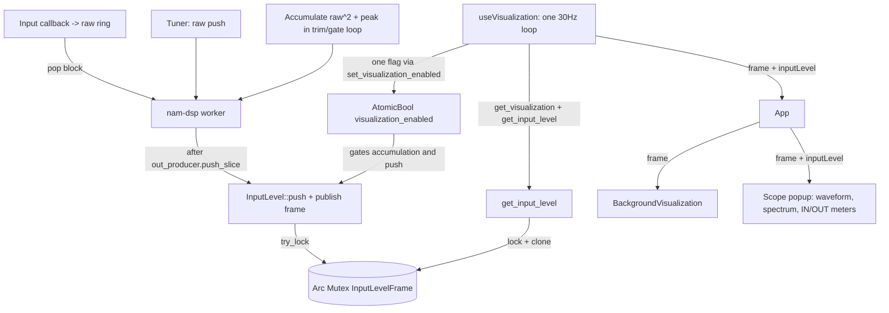

# Input Level Visualization for NAMpli

# Requirements

### Overview
Add an **Input** level meter to the existing Scope display. It shows the level of the **raw guitar
input** — the samples read from the input ring *before* the input trim/preamp knob, noise gate, NAM
model, cabinet IR, EQ, reverb and limiter — so the player can set their interface/pickup level
correctly. The existing level bar in the Scope keeps showing the **processed output**; the two meters
sit side by side with the same palette and a clip indicator.

This matters for gain staging: the current Scope tap reads the final output, where loudness
normalization and master gain hide an input that is already clipping at the audio interface. No
downstream knob can recover a clipped input, so the raw level needs its own readout. The meter is a
read-only observation and uses the one polling loop and one enable flag the Scope/background already
share — no second IPC stream, no extra DSP when nothing is displaying it.

### Goals
- Show the raw input level while playing: RMS, peak, a peak-hold marker and a latched clip indicator.
- Make it obvious when the signal is too hot **at the input**, independent of the Preamp knob or the
  bypass/model state (it works even with no NAM or IR loaded).
- Reuse the established architecture: analysis on the existing `nam-dsp` worker thread, hand-written
  DSP with no new crates (precedent: `tuner.rs`, `visualizer.rs`), a Tauri snapshot command, and the
  existing `useVisualization` polling hook.
- No allocation or locking in either cpal callback, no stream restarts, no change to the sound, and
  no change to preset/rig state.
- **Do not add a single sample of audio latency.** All publishing happens after the output block has
  been handed to the output ring, exactly like the Scope tap. See
  [Latency & CPU safety](#latency--cpu-safety).

### In Scope
- **Backend**: a self-contained `input_level` DSP module (rolling RMS/peak, peak-hold decay, clip
  latch), an accumulating tap in the worker's existing trim/gate loop, a snapshot store on
  `AudioEngine`, and a `get_input_level` command.
- **Frontend**: extend `useVisualization` to poll both snapshots in one loop, pass the input frame to
  the Scope popup, and render a second meter labelled `Input` beside the existing `Output` meter.
- **Docs**: extend the README's `Sound visualization` section.

### Out of Scope
- A second popup, title-bar button, or Settings toggle: the meter belongs to the Scope panel, which
  is already the analyser UI.
- A raw-input waveform/spectrum view, logging/recording, or per-channel (stereo) meters — v1 is a mono
  level readout (see Open decisions).
- Changing the Preamp/trim curve, gate, tuner, or any other DSP behaviour; the meter never alters the
  signal.
- New dependencies, rig-state/preset fields, or changes to the fixed window layout.

### UX behaviour
- The Scope popup's meter area shows two thin bars: `IN` above `OUT` (or side by side, whichever
  fits the existing popup width). Each uses the current green→gold→red segments, plus a small red dot
  that lights when a clip is detected.
- The input bar shows numeric dBFS (e.g. `-12.3 dB`) and a short peak-hold line that falls back over
  ~1 s, so a transient pluck is readable between 30 Hz polls.
- The clip dot latches for ~1 s after any sample at or above −0.1 dBFS, so a single clipped attack is
  not missed between polls.
- While powered off, or with the Scope closed, the meter is idle (flat/zero) and no analysis or IPC
  runs. Opening the Scope resets the analyser so the first reading is fresh, not stale.
- The `Output` meter is unchanged and keeps reflecting the post-limiter signal; no A/B switch or
  layout churn is needed.

# Technical Design

### Current Implementation
- **`src-tauri/src/audio_engine.rs:21`** — `MAX_BLOCK = 256`: the worker processes at most 256
  samples per iteration (~5 ms at 48 kHz), which is also a natural cadence for a level meter.
- **`src-tauri/src/audio_engine.rs:393–403`** — the input callback copies channel 0 into the raw ring
  with `try_push`; it must stay allocation- and lock-free. This is where the raw samples originate.
- **`src-tauri/src/audio_engine.rs:451–455`** — the worker pops a block into `buffer[..got]`.
- **`src-tauri/src/audio_engine.rs:487–493`** — `tuner.push(&buffer[..got])` already sees the raw
  input *before* trim/gate. This is the signal the new meter must measure; unlike the tuner, the
  meter's work is published after the output hand-off.
- **`src-tauri/src/audio_engine.rs:495–527`** — the trim/gate loop mutates `buffer[..got]` in place.
  It already iterates every raw sample, so summing squares/peak here costs only a few flops per sample
  and avoids a separate copy of the block.
- **`src-tauri/src/audio_engine.rs:548–593`** — NAM → IR → loudness → EQ → reverb → DC blocker/soft
  limiter, all in place.
- **`src-tauri/src/audio_engine.rs:595`** — `out_producer.push_slice(&buffer[..got])`: the hand-off
  after which visualization work cannot delay the device.
- **`src-tauri/src/audio_engine.rs:597–616`** — the existing Scope tap: on enable transition,
  `visualizer.prepare()` / clear the published frame; while enabled, `visualizer.push()` and publish
  with `try_lock()`. The input meter hooks into this same block.
- **`src-tauri/src/audio_engine.rs:159–162, 181–182`** — `visualization` snapshot and
  `visualization_enabled` flag on `AudioEngine`; **`src-tauri/src/audio_engine.rs:353, 722`** clear
  the frame on stream start/stop; **`:848–859`** are the read accessor and enable setter.
- **`src-tauri/src/visualizer.rs:13–34, 91–156`** — `VisualizationFrame`, `push()` and `analyze()`:
  the pre-allocated, publish-a-snapshot pattern to mirror (without the FFT).
- **`src-tauri/src/commands.rs:309–356`** — `TunerStatus`/`get_tuner` and
  `VisualizationStatus`/`get_visualization`/`set_visualization_enabled`, all camelCase serde structs.
- **`src-tauri/src/lib.rs:37–77`** — `generate_handler!` where `get_input_level` must be registered.
- **`src/tauri.ts:106–130`** — `getTuner()`, `VisualizationFrame`, `getVisualization()` and
  `setVisualizationEnabled()` bridges.
- **`src/hooks/useVisualization.ts:20–68`** — the single 33 ms polling loop, `document.hidden` gate,
  enable-flag effect, cancelled guard and stale-frame protection. `App` is its only caller.
- **`src/App.tsx:39–43, 88–92`** — popup state and the single `useVisualization(...)` call;
  **`:325–339`** — the Scope popup rendering `<Visualization frame={...} powered={...} />`.
- **`src/components/Visualization.tsx` / `.css`** — the waveform/spectrum canvases and the current
  RMS/peak level bar with clip dot; this is where the second meter goes.
- **`src/components/AudioStatusBar.tsx:8–29`** — a small always-visible status line; deliberately
  *not* used for the meter in v1 (see Open decisions).
- **`.junie/plans/sound-visualization.md`** and **`background-visualization.md`** — the designs this
  builds on; they define the "one hook, one poll, one flag, tap after hand-off" rules.

### Key Decisions
1. **Measure raw input, not the amp output.** Tap at the tuner's point in the graph (before
   trim/gate/NAM), because that is the level the player/interface controls. The existing post-limiter
   meter stays for hearing-level feedback; the two answer different questions.
2. **Accumulate in the trim/gate loop; publish after the output hand-off.** At `:505–527`, copy each
   raw sample into a local before it is trimmed (`let raw = *sample;`) and add `raw * raw` / `abs(raw)`
   to per-block accumulators. Pass those accumulators to `InputLevel::push()` only *after* `:595`.
   This adds no buffer, no allocation, and no work on the critical path to the audio device.
3. **One enable flag and one polling loop.** Reuse `visualization_enabled` and the existing
   `useVisualization` effect — the Scope already gates analysis on `open && powered && visible`. The
   input meter comes free whenever the Scope/background is active, and costs nothing otherwise. No
   `set_input_level_enabled` command is needed.
4. **Prefer a cheap meter over an FFT.** An input meter needs RMS/peak/peak-hold/clip only; a rolling
   sum of squares over ~100 ms plus a decaying peak-hold is a handful of flops per block, far cheaper
   than the Scope's 1024-point FFT. A raw-input waveform is deferred (Open decisions).
5. **Publish per block; poll at 30 Hz.** `push()` returns a frame on every worker iteration (~200 Hz
   at MAX_BLOCK = 256), so the newest snapshot is never older than ~5 ms. The UI keeps polling at
   33 ms, and `try_lock()` drops a frame if the poller holds the lock. This makes the bar feel
   immediate without 200 IPC messages/second.
6. **Peak-hold and clip latch live in Rust.** Decay on the worker (~1 s hold) so a transient remains
   visible across several UI polls, and latch a clip for ~1 s so it cannot be missed between them.
   The frontend only renders numbers it receives — no timers or extra state.
7. **Serde/shape mirror.** `InputLevelFrame` uses `#[serde(rename_all = "camelCase")]` on Rust and a
   matching TS interface (`levelDb`, `peakDb`, `peakHoldDb`, `clipped`), consistent with
   `VisualizationFrame`.
8. **No rig/preset impact.** The meter is observation only: no `AmpSettings`/`RigSnapshot` field, no
   dirty tracking, no global settings entry. Bypass with no NAM/IR still shows the input level.
9. **Keep the Scope self-contained.** The meter appears only in the Scope popup in v1. An always-on
   status-bar meter would keep DSP running while powered and needs its own flag decision — deferred.

### Latency & CPU safety
No cpal callback changes: no extra buffers, no device-period or `latency_frames` change, no locks in
either callback. The only possible effect is CPU contention on the `nam-dsp` worker, mitigated by:

1. **Publish after hand-off** — all `InputLevel` work and the snapshot write happen after
   `out_producer.push_slice` (`:595`), so they cannot delay samples already in the output ring.
2. **In-loop accumulation only** — a couple of flops per sample in a loop that already performs
   trim, gate and envelope tracking. No memcpy of the block, no allocation, no new thread.
3. **`try_lock()` publish** — never block the worker if the UI holds the snapshot lock; drop that
   frame instead.
4. **Gated at source** — the existing `visualization_enabled` flag means users who keep the Scope
   closed run the exact code path they have today; audio-critical sessions can leave it closed.
5. **Cheap by construction** — a rolling sum plus a peak-hold is orders of magnitude lighter than the
   Scope's FFT and the tuner's YIN analysis. Check the `AudioStatusBar` xrun counter with the Scope
   open and closed in `npm run tauri dev` (app crate builds at `opt-level = 1`, `Cargo.toml:24–25`).

Note: the display lags the signal by one 33 ms poll plus a canvas frame; that is visual latency only
and never affects the audio.

### Data model

```ts
// src/tauri.ts
export interface InputLevelFrame {
  levelDb: number;     // RMS of the rolling input window, dBFS
  peakDb: number;      // peak of that window, dBFS
  peakHoldDb: number;  // decaying peak-hold marker, dBFS
  clipped: boolean;    // latched for ~1s after a sample >= -0.1 dBFS
}
export async function getInputLevel(): Promise<InputLevelFrame | null>;
```

```rust
// src-tauri/src/input_level.rs
#[derive(Debug, Clone, Serialize)]
#[serde(rename_all = "camelCase")]
pub struct InputLevelFrame {
    pub level_db: f32,
    pub peak_db: f32,
    pub peak_hold_db: f32,
    pub clipped: bool,
}
```

### Architecture Diagram


### Proposed Changes

**Backend — `src-tauri/src/input_level.rs` (new)**
- Constants: `WINDOW_MS = 100.0`, `CLIP_DB = -0.1`, `CLIP_HOLD_S = 1.0`, `HOLD_DECAY_DB_PER_S ≈ 20.0`,
  `DB_MIN = -90.0`, `DB_MAX = 0.0`.
- `pub struct InputLevel` with a pre-allocated fixed-length ring (`Vec<f32>`, sized from sample rate),
  write index, running `sum_sq: f64`, `peak_hold_db`, `clip_until_sample: u64` (or a countdown in
  samples), `sample_rate`, and a `block_index`.
- `pub fn new(sample_rate: f32)` and `pub fn prepare(&mut self, sample_rate: f32)` (clears history on
  stream restart and on Scope re-enable).
- `pub fn push(&mut self, block_sum_sq: f64, block_peak: f32) -> InputLevelFrame`: write the block's
  aggregate into the rolling structure (no sample-level ring needed when only levels are exposed —
  keep the ring only if a waveform is later added), update RMS/peak over the window, decay peak-hold,
  latch/expire clip, and return a fresh frame every call. No allocation.
- Helper: `fn dbfs(amplitude: f32) -> f32` with the standard `20 * log10` clamp to `DB_MIN..DB_MAX`.
- Unit tests: silence → very low `levelDb`/`peakDb`, no clip; a 0.5 sine → ~−9 dBFS RMS and
  ~−6 dBFS peak; a full-scale sample sets `clipped = true` and it clears after the hold; a decaying
  peak-hold falls monotonically; `prepare()` clears state; all outputs finite and bounded.

**Backend — `src-tauri/src/audio_engine.rs`**
- `mod input_level` import; add `input_level: Arc<Mutex<Option<InputLevelFrame>>>` to `AudioEngine`
  next to `visualization` (`:159`), initialize in `new()` (`:181`), clear it alongside the Scope frame
  at `:353` (`start()`) and `:722` (`stop()`).
- Clone both new `Arc`s into the worker (`:389–390`). Construct `let mut input_level =
  InputLevel::new(sample_rate);` alongside `Visualizer::new` (`:440`).
- Load `visualization_enabled` once per block (near the parameter snapshot at `:457`) into a local
  (e.g. `vis_enabled`) and use it for both the cheap accumulation and the post-hand-off publish; a
  mid-block toggle takes effect on the next block.
- In the trim/gate loop (`:505–527`), when `vis_enabled`, capture `let raw = *sample;` before scaling
  and accumulate `input_sum_sq += raw as f64 * raw as f64` and `input_peak = input_peak.max(raw.abs())`.
  Initialize both to zero before the loop. When disabled, skip both statements entirely.
- After `out_producer.push_slice` (`:595`), extend the existing enabled-transition block: on
  disabled→enabled call both `visualizer.prepare(sample_rate)` and `input_level.prepare(sample_rate)`;
  on enabled→disabled clear both snapshots; while enabled call
  `input_level.push(input_sum_sq, input_peak)` and publish with `try_lock()`. Keep the current Scope
  logic byte-for-byte otherwise.
- `pub fn input_level(&self) -> Option<InputLevelFrame>` read accessor, mirroring `visualization()`
  (`:848–851`). No new setter: the existing `set_visualization_enabled` gates both analysers.

**Backend — `src-tauri/src/commands.rs`**
- Add `#[derive(Debug, Clone, Serialize)] #[serde(rename_all = "camelCase")] struct InputLevelStatus`
  with `level_db`, `peak_db`, `peak_hold_db`, `clipped`, and a `get_input_level` command returning
  `Result<Option<InputLevelStatus>, String>`, mirroring `get_visualization` (`:325–345`).

**Backend — `src-tauri/src/lib.rs`**
- Add `mod input_level;` and register `commands::get_input_level` in `generate_handler!` (`:37–77`).

**Frontend — `src/tauri.ts`**
- Add the `InputLevelFrame` interface and `getInputLevel()` bridge (invoke `get_input_level`).

**Frontend — `src/hooks/useVisualization.ts`**
- In the existing `poll()` (`:47–54`), fetch both snapshots with `Promise.all` (or sequential awaits)
  and return them together. Change the hook's return type from `VisualizationFrame | null` to
  `{ frame: VisualizationFrame | null; inputLevel: InputLevelFrame | null }` (or add a second field to
  the current `Snapshot` struct so stale-frame guards still work). Keep the 33 ms interval, the
  `cancelled` guard, the enable-flag effect and the `document.hidden` gating unchanged — still one
  loop, one flag, one cleanup path.

**Frontend — `src/App.tsx`**
- Destructure `const { frame: visualizationFrame, inputLevel } = useVisualization(...)` (`:89–92`).
- Pass `inputLevel={inputLevel}` to `<Visualization>` (`:325–339`). No change to
  `<BackgroundVisualization>` (it keeps using `visualizationFrame`), no new popup state or
  `useDialogFocus` entry, no change to the title bar.

**Frontend — `src/components/Visualization.tsx` / `.css`**
- Add an `inputLevel: InputLevelFrame | null` prop. Render a second meter row above the existing
  level bar: `IN` label, segmented bar filled from `levelDb`, a peak-hold marker at `peakHoldDb`, a
  dBFS readout, and a clip dot when `clipped`. Keep the existing `OUT` bar exactly as-is.
- When `inputLevel === null` (power off / before the first frame), show the idle/zero state. Reuse
  theme variables and the existing `.visualization-level*` classes; add only a small `.visualization-input-*`
  block if needed. No layout/window-size change.

**Docs — `README.md`**
- Extend the `Sound visualization` section: the Scope now shows a raw input meter beside the output
  meter, what it measures (pre-preamp/gate/NAM), that it reveals interface clipping, and that it stays
  read-only / off when the Scope is closed.

### Delivery Steps

- [ ] **Step 1 — Input level DSP module.** Add `input_level.rs` with the rolling levels, peak-hold,
      clip latch and unit tests. Verify `cargo test -p app`.
- [ ] **Step 2 — Engine + command wiring.** Add the snapshot store, worker instance, in-loop
      accumulation and post-hand-off publish, the accessor, `get_input_level` and its `lib.rs`
      registration. Verify `cargo check` in `src-tauri/`; confirm the Scope tap is untouched.
- [ ] **Step 3 — Frontend bridge + hook.** Add `getInputLevel()` and extend `useVisualization` to poll
      both snapshots in one loop with stale-frame protection. Verify `npm run build` / `npm run lint`.
- [ ] **Step 4 — UI.** Add the `IN` meter to the Scope popup, pass the prop from `App`, check the
      fixed 1200×650 layout and the idle state.
- [ ] **Step 5 — QA + docs.** Update README. Manual checklist: power on → play → input bar tracks the
      pickup; turn the Preamp knob → input bar stays put while the output bar changes (proves the tap
      is pre-trim); engage the gate → input bar still shows quiet passages; pop a string hard → clip
      dot latches; unplug/quiet input → both bars fall to idle; power cycle → meter clears then resumes;
      Scope closed → no new polling/IPC and `AudioStatusBar` xrun count stays flat with the background
      off; no NAM/IR loaded → input meter still works.

### Open decisions (resolve during implementation)
- **Placement**: recommended second meter inside the Scope popup (one flag, one loop). An always-visible
  mini meter in `AudioStatusBar` would help continuous gain staging but would need its own enable gate
  so it does not keep DSP running with the Scope and background both closed.
- **Waveform vs. level only**: recommended level-only for v1. Adding a raw-input waveform needs a
  pre-trim copy of each block (a 256-float memcpy into a preallocated buffer, still off the audio
  callback) and a second `Vec` in the frame; cheap, but beyond what gain staging requires.
- **Clip threshold / hold**: `−0.1 dBFS` and ~1 s are starting points; tune so interface blips are
  visible without staying lit for ordinary playing. Note the meter measures f32 samples from cpal,
  which may exceed ±1.0 depending on the device.
- **RMS window**: ~100 ms is a trade-off between responsiveness and a stable reading for bass notes;
  a shorter window (~50 ms) feels snappier but bounces more. Keep it independent of the Scope's FFT
  size.
- **Peak-hold decay**: ~20 dB/s recommended; slower holds read better for fast transients, faster ones
  track knob turns more closely.
- **Publish cadence**: per block (~200 Hz) recommended so polls at 33 ms always see a fresh value. If
  `try_lock()` drops too many frames under load, publish every other block instead — no frontend change.
- **Combined command**: an alternative to two invokes per poll is one `get_analyzer()` command returning
  both frames; it reduces IPC calls but adds a command and changes the hook's transport. Not needed
  unless profiling shows the extra invoke matters.
- **Channel layering**: v1 shows channel 0 (mono input), matching the tuner and the mono DSP pipeline;
  stereo meters would need changes to the input callback, which is deliberately out of scope.
