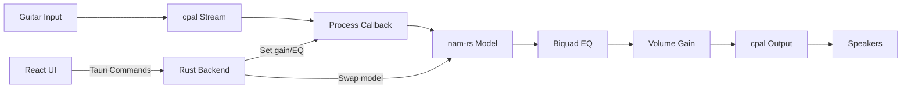

# Requirements

### Overview & Goals
Migrate the JCM800 NAM Player from Electron to Tauri and integrate real-time neural amp modeling using the 10 `.nam` files in `./nams`. The app will capture live guitar input via an audio interface, process it through a NAM model selected based on the current Gain knob position and Input sensitivity (Hi/Lo), apply post-NAM EQ (Bass, Middle, Treble), and output to the user's speakers/headphones.

### User Stories
- As a guitarist, I want to plug in my guitar and hear it processed through a JCM800 amp model in real time
- As a guitarist, I want to adjust the Gain knob and hear the tone change (switching between NAM models G2–G10)
- As a guitarist, I want to toggle between Hi/Lo input sensitivity and have the app switch to the matching NAM model
- As a guitarist, I want to shape my tone with Bass, Middle, Treble, and Master Volume knobs
- As a user, I want a small, fast desktop app (Tauri vs Electron)

### Scope
**In Scope:**
- Migrate from Electron to Tauri v2 (Rust backend + React frontend)
- Native audio I/O via `cpal` crate (input capture + output playback)
- NAM model inference via `nam-rs` crate (pure Rust, real-time safe)
- Auto-switch NAM models based on Gain level (1→G2, 2→G4, 3→G6, 4→G8, 5→G10) and sensitivity (Hi/Lo)
- Post-NAM EQ processing (Bass, Middle, Treble) via biquad filters in Rust
- Master Volume control via sample gain
- Copy the 10 `.nam` files from `./nams` into the Tauri assets
- Keep the existing React UI (knobs, power switch, settings panel)

**Out of Scope:**
- Impulse Response (IR) loading
- Preset save/load
- Effects chain (reverb, delay, etc.)
- Mobile support
- VST/CLAP plugin format

### NAM File Mapping
| Gain Knob | Sensitivity Hi | Sensitivity Lo |
|-----------|---------------|---------------|
| 1 | `JCM800 Hi P6 B8 M4 T7 G2.nam` | `JCM800 Lo P6 B8 M4 T7 G2.nam` |
| 2 | `JCM800 Hi P8 M4 T7 G4.nam` | `JCM800 Lo P6 B8 M4 T7 G4.nam` |
| 3 | `JCM800 Hi P6 B8 M4 T7 G6.nam` | `JCM800 Lo P6 B8 M4 T7 G6.nam` |
| 4 | `JCM800 Hi P6 B8 M4 T7 G8.nam` | `JCM800 Lo P6 B8 M4 T7 G8.nam` |
| 5 | `JCM800 Hi P6 B8 M4 T7 G10.nam` | `JCM800 Lo P6 B8 M4 T7 G10.nam` |

### Non-Functional Requirements
- **Latency**: Target <10ms round-trip audio latency
- **Real-time safety**: No heap allocations on the audio thread
- **Bundle size**: Tauri app <20MB (vs Electron ~150MB+)
- **Sample rate**: 48kHz (matching NAM model expectations)

# Technical Design

### Current Implementation
- **React + TypeScript + Vite** frontend with JCM800 amp UI (knobs for Gain, Bass, Middle, Treble, Master Volume)
- **Electron** desktop shell (`electron/main.ts`, `electron/preload.ts`)
- `useAmpSettings` hook with `#TODO` markers for audio engine integration
- Placeholder `.nam` files in `public/models/` (text placeholders, not real models)
- `SettingsPanel` with audio device enumeration already implemented
- `AmpSettings` interface and `NamModel` type in `src/types/amp.ts`

### Key Decisions
1. **Tauri v2** for desktop shell — smaller bundle, better performance, Rust backend for native audio
2. **`nam-rs` crate** for NAM inference — pure Rust, real-time safe, supports SlimmableContainer (A2) models, no heap allocation on audio thread
3. **`cpal` crate** for audio I/O — cross-platform, low-level, supports ASIO on Windows for low latency
4. **Combined input/output stream** in cpal — captures guitar input and plays processed output in a single callback for minimal latency
5. **Post-NAM biquad EQ** in Rust — Bass/Middle/Treble filters applied after NAM processing (since all NAM files were trained with fixed P6/B8/M4/T7)
6. **Model preloading** — all 10 NAM models loaded at startup into memory; switching is instant (no disk I/O on audio thread)
7. **Keep React UI unchanged** — the frontend components, hooks, and CSS remain the same; only the backend changes from Electron IPC to Tauri commands

### Architecture



### Proposed Changes

#### 1. Tauri Setup
- Remove Electron dependencies and configuration
- Add Tauri v2 to the project (`cargo init` for Rust backend, Tauri config)
- Configure `Tauri.conf.json` with app metadata, window settings, and dev URL
- Copy `.nam` files from `./nams` to `src-tauri/nams/` for bundling

#### 2. Rust Audio Engine (`src-tauri/src/audio_engine.rs`)
- Create `AudioEngine` struct with:
  - `cpal` stream for combined input/output (full-duplex)
  - `nam-rs` Model instance (current active model)
  - Preloaded `HashMap<(sensitivity, gain_level), Model>` for all 10 models
  - Biquad filter chain (low-shelf for Bass, peaking for Middle, high-shelf for Treble)
  - Atomic/shared state for knob values (Gain, Bass, Middle, Treble, Master Volume, sensitivity, power)
  - Warmup/settling logic for WaveNet models on load

#### 3. Tauri Commands (`src-tauri/src/commands.rs`)
- `start_audio(input_device: Option<String>, output_device: Option<String>)` — start the cpal stream
- `stop_audio()` — stop the stream
- `set_gain_level(level: u32)` — switch NAM model and update state
- `set_bass(value: f32)`, `set_middle(value: f32)`, `set_treble(value: f32)` — update EQ filter coefficients
- `set_master_volume(value: f32)` — update output gain
- `set_sensitivity(sensitivity: String)` — "high" or "low", triggers model switch
- `toggle_power()` — start/stop audio
- `list_audio_devices()` — return available input/output devices for SettingsPanel

#### 4. React Frontend Updates
- Replace Electron IPC (`window.electronAPI`) with Tauri's `invoke()` from `@tauri-apps/api/core`
- Update `useAmpSettings` hook to call Tauri commands instead of `#TODO` markers
- Update `SettingsPanel` to use Tauri's `list_audio_devices` command
- Update `electron.d.ts` → `tauri.d.ts` with Tauri command signatures
- Remove Electron-specific files (`electron/`, `vite.config.electron.ts`, etc.)

#### 5. NAM Model Loading
- On app startup, load all 10 `.nam` files from bundled assets using `nam-rs::NamModel::from_file`
- Map each to `(sensitivity, gain_level)` key
- Pre-warmup each model (process silence for `receptive_field()` samples)
- Store in the `AudioEngine` for instant switching

### File Structure
```
jcm800/
├── src/                          # React frontend (unchanged structure)
│   ├── components/
│   ├── hooks/useAmpSettings.ts   # Updated: Tauri commands instead of TODOs
│   ├── types/amp.ts              # Updated: remove NamModel, keep AmpSettings
│   ├── tauri.d.ts                # New: Tauri command type declarations
│   └── App.tsx, main.tsx, ...
├── src-tauri/                    # New: Tauri Rust backend
│   ├── src/
│   │   ├── main.rs               # Tauri app entry point
│   │   ├── audio_engine.rs       # cpal stream + nam-rs + EQ processing
│   │   ├── commands.rs           # Tauri IPC commands
│   │   ├── eq.rs                 # Biquad filter implementation
│   │   └── model_manager.rs      # NAM model loading, mapping, switching
│   ├── nams/                     # NAM files copied from ./nams
│   ├── Cargo.toml                # Rust deps: tauri, cpal, nam-rs, serde
│   └── Tauri.conf.json           # Tauri app config
├── package.json                  # Updated: Tauri scripts, remove Electron
├── vite.config.ts                # Updated: Tauri plugin
└── nams/                         # Original NAM files (kept as source)
```

### Data Models / Contracts

#### Tauri Command Signatures (Rust → TypeScript)
```typescript
// In tauri.d.ts
interface Window {
  __TAURI__: {
    invoke: <T>(command: string, args?: any) => Promise<T>;
  };
}

// Commands
invoke('start_audio', { inputDevice, outputDevice }): Promise<void>
invoke('stop_audio'): Promise<void>
invoke('set_gain_level', { level: number }): Promise<void>
invoke('set_bass', { value: number }): Promise<void>
invoke('set_middle', { value: number }): Promise<void>
invoke('set_treble', { value: number }): Promise<void>
invoke('set_master_volume', { value: number }): Promise<void>
invoke('set_sensitivity', { sensitivity: 'high' | 'low' }): Promise<void>
invoke('toggle_power'): Promise<void>
invoke('list_audio_devices'): Promise<{ inputs: string[], outputs: string[] }>
```

### Risks
- **cpal device selection**: Device IDs may change between sessions; the SettingsPanel may need to re-enumerate on startup
- **Model warmup latency**: Each model needs ~receptive_field samples of warmup; preloading all 10 models at startup adds ~1-2 seconds to launch
- **Sample rate mismatch**: If the audio device runs at a rate different from 48kHz, the NAM output will be wrong; the engine should resample or enforce 48kHz
- **Memory**: 10 preloaded models ≈ ~3MB each = ~30MB RAM; acceptable for desktop
- **Tauri migration**: The existing React UI may need minor adjustments for Tauri's security model (CSP, etc.)

# Testing

### Validation Approach
The agent will verify the implementation by:
1. Confirming the Tauri project builds successfully (`cargo build` in `src-tauri/`)
2. Verifying the React frontend builds with Vite
3. Checking that all 10 NAM files are properly bundled and loadable
4. Validating that Tauri commands are properly wired from React to Rust

### Key Scenarios
- **Power On**: User clicks power switch → audio stream starts → test signal or live input is processed through NAM model
- **Gain Switch**: User turns Gain knob → model switches instantly (no audio glitch) → tone changes
- **Sensitivity Switch**: User toggles Hi/Lo → model switches to matching sensitivity → tone changes
- **EQ Adjustment**: User turns Bass/Middle/Treble → EQ filter coefficients update → tone changes in real time
- **Master Volume**: User turns Master Volume → output gain changes → volume changes
- **Audio Device Selection**: User opens settings → sees device list → selects different input/output → audio reroutes

### Edge Cases
- **No audio input device**: App should handle gracefully (show error in settings, disable power)
- **Microphone access denied**: App should prompt user and handle denial
- **Model file missing**: App should log error and fall back to a default model
- **Rapid knob changes**: EQ coefficients should update atomically to avoid clicks/pops
- **Model switch during playback**: Should crossfade or reset cleanly to avoid audio artifacts
- **Sample rate mismatch**: Engine should detect and either resample or warn the user

### Test Changes
- No existing tests to update (current project has no test suite)
- Consider adding Rust unit tests for:
  - EQ filter coefficient calculation
  - NAM model file loading
  - Model mapping logic (gain + sensitivity → filename)

# Delivery Steps

### ✓ Step 1: Migrate from Electron to Tauri
Set up the Tauri v2 project structure and remove all Electron dependencies.
- Remove `electron/`, `dist-electron/`, `vite.config.electron.ts`, `tsconfig.electron.json`, and `scripts/dev-electron.sh`
- Initialize `src-tauri/` with `cargo init`, add Tauri dependencies to `Cargo.toml` (tauri, serde, serde_json, cpal, nam-rs)
- Create `Tauri.conf.json` with app metadata (JCM800 NAM Player, 1200x650 window, dev URL)
- Update `package.json`: replace Electron scripts with Tauri scripts (`tauri dev`, `tauri build`), add `@tauri-apps/api` dependency
- Update `vite.config.ts` to use `@tauri-apps/plugin` instead of Electron
- Copy all 10 `.nam` files from `./nams/` to `src-tauri/nams/`
- Create `src-tauri/src/main.rs` with basic Tauri app entry point
- Verify the app launches with a blank React UI in Tauri window

### ✓ Step 2: Implement Rust audio engine with cpal + nam-rs
Build the core audio processing pipeline in Rust: capture input, process through NAM, apply EQ, output audio.
- Create `src-tauri/src/audio_engine.rs` with `AudioEngine` struct holding cpal stream, current NAM model, EQ state, and shared knob values
- Create `src-tauri/src/model_manager.rs` to load all 10 NAM files at startup, map them by (sensitivity, gain_level), and pre-warmup each model
- Create `src-tauri/src/eq.rs` with biquad filter chain: low-shelf (Bass, ~100Hz), peaking (Middle, ~1kHz), high-shelf (Treble, ~3kHz)
- Implement full-duplex cpal stream (input + output in single callback) at 48kHz
- Wire the process callback: input → NAM model → EQ filters → volume gain → output
- Ensure no heap allocations on the audio thread (real-time safety)
- Store `AudioEngine` in Tauri's app state for command access

### ✓ Step 3: Implement Tauri IPC commands
Create the bridge between React UI and Rust audio engine via Tauri commands.
- Create `src-tauri/src/commands.rs` with all Tauri commands:
  - `start_audio(input_device, output_device)` — start cpal stream with selected devices
  - `stop_audio()` — stop the stream gracefully
  - `set_gain_level(level)` — switch NAM model based on gain + current sensitivity
  - `set_bass(value)`, `set_middle(value)`, `set_treble(value)` — update EQ filter coefficients atomically
  - `set_master_volume(value)` — update output gain
  - `set_sensitivity(sensitivity)` — update sensitivity and trigger model switch
  - `toggle_power()` — start/stop audio
  - `list_audio_devices()` — enumerate available input/output devices via cpal
- Register all commands in `main.rs`
- Create `src/tauri.d.ts` with TypeScript command signatures (replace `electron.d.ts`)

### ✓ Step 4: Wire React frontend to Tauri commands
Update the React frontend to use Tauri commands instead of Electron IPC and #TODO markers.
- Update `src/hooks/useAmpSettings.ts`: replace all `#TODO` comments with actual `invoke()` calls to Tauri commands
- Update `src/components/SettingsPanel.tsx`: replace `navigator.mediaDevices` with Tauri's `list_audio_devices` command for device selection
- Update `src/types/amp.ts`: remove `NamModel` and `NAM_MODELS` (no longer needed, handled by Rust)
- Remove `src/electron.d.ts`, keep `src/tauri.d.ts`
- Update `src/App.tsx` if any Electron-specific code remains
- Verify the full flow: power on → audio starts → gain switch → model changes → EQ adjusts → volume changes