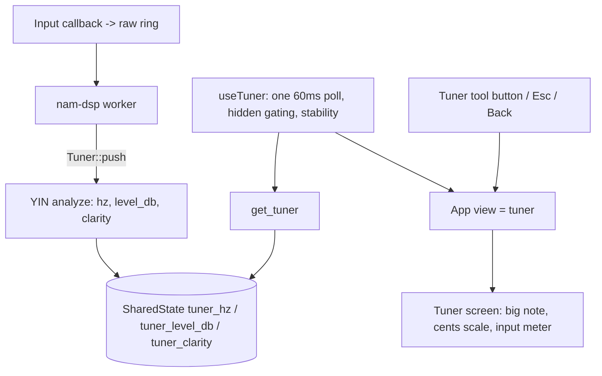

# Larger, Better Tuner for NAMpli

> **Status: implemented (frontend).** The tuner is now a full-window view with a large note,
> labeled ±50-cent scale, input-level bar, stabilized readings and reference-pitch control. The
> backend `clarity` enrichment in the design below was **deferred**: the delivered hook uses the
> existing `hz` + `levelDb` snapshot, so `get_tuner` and the Rust files are unchanged.

# Assumptions

The request was to make the tuner "bigger (screen wise) and better". This plan assumes:

1. **Bigger means it owns the screen** — a full-window tuner view that replaces the amp panel,
   mirroring the established `PresetLibrary` view pattern, rather than a slightly larger modal.
   The app window itself stays at its current fixed 1200×650 (see *Open decisions* if a physically
   larger window is wanted).
2. **Better means** a readable large display, a real ±50-cent scale, visible signal strength using
   the `levelDb` value the backend already reports, and a steadier reading that does not flicker
   between notes. Pitch detection itself (YIN) stays as-is; this is a presentation and stability
   change, not a DSP rewrite.
3. Optional niceties (reference pitch selector, keyboard shortcut) are included as small items but
   are called out so they can be dropped without affecting the core change.

If a large **overlay** is preferred instead of a view swap, the UI portion of this plan can be
re-scoped: keep `showTuner`, delete the `view` changes, and grow `.tuner-popup` to roughly 640×360
centered. Everything else (data, stability, input level, cleanup) applies unchanged.

# Context

The tuner is reached from the top-right tool button and currently renders as a small modal:
`.tuner-popup` is pinned to the top-right of a dimmed overlay and its inner `.tuner` is **220px
wide** with a **1.6rem** note and a **6px** needle bar
(`src/App.tsx:319–336`, `src/App.css:118–163`, `src/components/Tuner.css:1–123`). On a 1200×650
window that is less than 6% of the screen area — easy to miss and hard to read at a glance while
playing.

The backend already does the hard part: `src-tauri/src/tuner.rs` runs a sample-rate-scaled YIN
detector on raw input in the DSP worker, and `get_tuner` publishes both pitch and input level
(`src-tauri/src/commands.rs:309–324`). The frontend throws half of that away: `Tuner.tsx:35–36`
stores only `reading.hz` and ignores `levelDb`, so there is no way to tell "no signal" from
"unstable pitch", and no gain-staging feedback.

There is also leftover dead CSS: `.tuner`'s base rules position it as a fixed 170px HUD at the top
left with `pointer-events: none`; nothing renders that variant anymore because the only consumer is
inside `.tuner-popup`, which overrides it. The modal machinery (`tunerPopupRef`, the tuner
`useDialogFocus` call) exists solely for this small popup.

# Goals / Non-goals

**Goals**
1. The tuner uses the whole app window: a large note readout, a large cents scale, and an input-level
   indicator, all readable from a few feet away.
2. No page scrolling; the fixed 1200×650 window never overflows.
3. The display is stable: no rapid flipping between adjacent notes, no stale pitch held after the
   string stops, and an explicit no-signal / powered-off state.
4. Reuse the existing data path: one `get_tuner` invoke per poll, no new IPC stream, no audio-thread
   work beyond what YIN already does, no change to latency or sound.
5. Navigation matches the library: button to enter, visible **← Back to amp** and **Esc** to leave,
   with focus returned to the tuner button.
6. Remove the dead popup/HUD code instead of layering more overrides.

**Non-goals**
- Replacing YIN, changing pitch range (25–1400 Hz), or adding polyphonic detection.
- Changing presets, rig state, audio routing, gate/trim behavior or any knob sound.
- A second always-on tuner HUD over the amp, or tuner state saved in presets.
- Resizing the application window (listed as an open decision).
- New npm/Cargo dependencies.

# UX design

### View switch
- Extend `App`'s view union from `'amp' | 'library'` to `'amp' | 'library' | 'tuner'`
  (`src/App.tsx:38`). Opening from `TunerIcon` sets `view = 'tuner'`; the amp panel is not rendered
  while the tuner is open, exactly like the library.
- Keep window tools, `AudioStatusBar`, `Toast`, the audition banner and the drop-zone overlay
  mounted in every view.
- Exit via **← Back to amp** or **Esc**; both call `backToAmp()` and restore focus to whichever
  trigger was used (see *Key precedence*).
- The tuner is a **view, not a dialog**: no `role="dialog"`, no `useDialogFocus` trap, no dimmed
  overlay. That also means the global key handler in `App.tsx:149–181` starts seeing keys again.

### Layout (fixed 1200×650, no scrolling)
```
┌──────────────────────────────────────────────────────────────────────┐
│ window tools · status bar · (audition banner when previewing)       │
├──────────────────────────────────────────────────────────────────────┤
│ ← Back to amp      TUNER      Ref: A4=440 [−] [+]      ● Live/Standby │
├──────────────────────────────────────────────────────────────────────┤
│                                                                      │
│                         A#3                                          │
│                    −12 cents   ·   228.1 Hz                          │
│                                                                      │
│   ┌────────────────────────────────────────────────────────────────┐ │
│   │ −50      −25       0       +25       +50  (cents, flat→sharp)  │ │
│   │ |---------|---------█---------|---------|----------------------| │
│   └────────────────────────────────────────────────────────────────┘ │
│                                                                      │
│   INPUT  [▁▂▃▅▆▇▆▃▁]   −24.6 dB        ● signal / ○ no signal       │
├──────────────────────────────────────────────────────────────────────┤
│ Esc: back to amp · play a single note · works with the gate closed   │
└──────────────────────────────────────────────────────────────────────┘
```
- Note: `clamp(5rem, 14vw, 9rem)` weight 800, gold; turns green with a soft glow inside ±5 cents
  (the current in-tune rule).
- Cents scale: a centered bar at least 70% of window width, height ~22–28px, with labeled ticks at
  −50/−25/0/+25/+50, a bright center band for ±5, and a needle/tip that eases over ~0.12 s. Flat
  reads left, sharp reads right (same sign convention as today).
- Input meter: a horizontal segmented bar plus numeric dBFS, driven by `levelDb`; a separate
  `No signal` state replaces the note when there is no usable input. It measures the *raw* input tap
  (before trim/gate/NAM), so it still responds with the gate closed or in bypass.
- Header shows power state; when powered off, the panel shows a dimmed `Standby` state and no
  pitch polling runs (same rule as today).
- Ref pitch control: small `− / +` stepper in 1 Hz steps (or a 432/440/442 select) applied only to
  note naming, never to detection or audio. Default 440 Hz.

### States
| State | Note area | Meter | Trigger |
|---|---|---|---|
| Standby | `—`, dimmed | idle | `powered === false` |
| No signal | `—`, muted | empty bar, `No signal` | `hz === 0` or `levelDb < −70`, sustained ~300 ms |
| Searching | last note dimmed | low-level bar | level present but no stable pitch yet |
| In tune | big green note, glow | needle inside center band | `abs(cents) <= 5` and stable |
| Out of tune | big gold note | needle left/right | stable pitch, larger cents |

### Key precedence
Today `Esc` reverts an audition, otherwise leaves the library (`src/App.tsx:153–158`). Extend the
same order with the tuner view:

- **Esc**: audition active → revert and stay in the current view; else if `view !== 'amp'` → `backToAmp()`.
- **Enter**: audition active → keep; else library selection → audition (unchanged). Tuner has no
  Enter action so audition behavior stays unambiguous.
- **Back button** is always available, so no keyboard rule is the only way out.
- `backToAmp()` must focus the right trigger: add `data-tuner-trigger` to `TunerIcon` and keep
  `data-preset-library-trigger`, then choose based on the view being left. Its current hard-coded
  library focus (`src/App.tsx:54–59`) is otherwise wrong when returning from the tuner.
- Optional `Ctrl/Cmd+T` toggles the tuner view; defined in the same handler with `preventDefault`.

# Technical design

### Current implementation
- `src-tauri/tauri.conf.json:11–19` — fixed 1200×650, non-resizable window.
- `src/App.tsx:35–60` — `showTuner`, `view`, `openTuner`/`closeTuner`; `:142` — tuner dialog focus;
  `:149–181` — global key precedence; `:319–336` — modal popup markup.
- `src/App.css:118–163` — `.tuner-popup-overlay`, `.tuner-popup`, `.tuner-popup .tuner` (220px),
  `.tuner-popup-close`.
- `src/components/Tuner.tsx:26–78` — 120 ms poll, `getTuner()` → `hz` only, inline note math,
  note/cents/needle markup. `Tuner.css:1–123` — fixed 170px HUD base + popup overrides.
- `src/tauri.ts:106–113` — `TunerStatus { hz, levelDb }` and `getTuner()`.
- `src-tauri/src/commands.rs:309–324` — camelCase `TunerStatus` and `get_tuner`.
- `src-tauri/src/audio_engine.rs:474–477` — worker writes `tuner_hz` / `tuner_level_db` from raw
  input, before trim/gate; `:805–809` — `tuner()` accessor. No stream or callback changes needed.
- `src-tauri/src/tuner.rs:17–29` — 25–1400 Hz, threshold 0.2, silence RMS; `:115–210` — analysis
  produces `TunerReading { hz, level_db }`; the normalized difference `self.norm[tau]` at the chosen
  lag already encodes pitch clarity but is discarded.
- `src/hooks/useDialogFocus.ts:7–10` — doc comment lists Tuner as a consumer; update when removed.
- `src/components/PresetLibrary.tsx` / `.css` — the full-window view pattern to mirror (own header,
  internal layout, `onBack`, no scrolling).

### Key decisions
1. **View, not modal.** A view gives the display the entire window, avoids stacking another dialog
   over the audition banner, and reuses a navigation model users already know from the library.
2. **Keep polling in one hook, not in the component.** Extract the current effect into
   `src/hooks/useTuner.ts` (mirroring `useVisualization`): one `getTuner()` invoke per tick, a
   `cancelled` guard, `document.hidden` gating, and cleanup. The component becomes presentation
   only. Poll faster than the backend analysis so updates are not aliased.
3. **Poll at ~60 ms, not 120 ms.** The backend analyzes once per ~120 ms window at 48 kHz
   (`tuner.rs:80`, `WINDOW_PERIODS = 3` at 25 Hz). Polling at exactly that cadence can repeatedly
   read the same snapshot or skip a fresh one. A 60 ms poll sees each new reading within one tick.
4. **Add pitch clarity to the snapshot (recommended).** `TunerReading` gains `clarity: f32` derived
   from the already-computed `1.0 - self.norm[tau]` (clamped 0..1) at the selected lag, plus a
   boolean for the silence case; it flows through `TunerStatus` (camelCase `clarity`) to the hook.
   This is a few flops in existing code, no new DSP pass and no latency impact. The UI uses it to
   hold the last note briefly and to avoid reporting noise as a note.
5. **Stabilize in the hook, not in Rust.** Keep backend output pure per-window. The hook applies:
   a short hold (~300 ms) before switching to `No signal` after `hz === 0`, a two-consecutive-reading
   rule before changing the note name (adjacent semitone flips), and light cents smoothing
   (e.g. exponential, α ≈ 0.4) for the needle. Large jumps (>3 semitones) apply immediately.
6. **Use `levelDb` for the input bar and signal gate.** Threshold ~−70 dB means "no signal"; the bar
   maps −60..0 dB to 0..100%. No clip flag in v1 — the backend reports RMS only, and adding peak
   detection would be a separate DSP change.
7. **Reference pitch is display-only.** Shift the MIDI math by `1200 * log2(refHz / 440)` cents;
   detection, `hz`, and audio are untouched. Keep it in component/local state (no preset or global
   settings field in v1).
8. **Delete the old surface.** Remove `showTuner`, `tunerPopupRef`, its `useDialogFocus` call, the
   `.tuner-popup*` rules, and the dead fixed-HUD base rules in `Tuner.css`. No compatibility shim.

### Data model
```ts
// src/tauri.ts
export interface TunerStatus {
  hz: number;       // 0 when no stable pitch
  levelDb: number;  // RMS of the raw input window, dBFS
  clarity: number;  // 0..1, how periodic the detected pitch was
}
```
```rust
// src-tauri/src/tuner.rs
pub struct TunerReading {
    pub hz: f32,
    pub level_db: f32,
    pub clarity: f32, // 1 - norm[tau], clamped 0..1; 0 for silence / no dip
}
// src-tauri/src/commands.rs
#[serde(rename_all = "camelCase")]
pub struct TunerStatus { hz: f32, level_db: f32, clarity: f32 }
```
```ts
// src/hooks/useTuner.ts
interface TunerSnapshot {
  hz: number;
  levelDb: number;
  clarity: number;
  note: string | null;     // e.g. "A#3", after reference-pitch offset
  cents: number;           // smoothed, −50..+50
  inTune: boolean;
  hasSignal: boolean;
}
```

### Architecture diagram


### Proposed changes

**Backend — `src-tauri/src/tuner.rs`**
- Add `clarity: f32` to `TunerReading` (default 0.0 via `Default`).
- In `analyze()`, compute `clarity` from `self.norm[tau]` just before returning `hz`:
  `1.0 - self.norm[tau].clamp(0.0, 1.0)`; set 0.0 on all early/no-pitch returns. The parabolic
  interpolation stays unchanged.
- Unit tests: pure sine → `clarity > 0.9`; white noise / no dip → low clarity and `hz == 0`;
  silence → `hz == 0`, `clarity == 0`; keep the existing bass/sample-rate tests green.

**Backend — `src-tauri/src/audio_engine.rs` / `src-tauri/src/commands.rs`**
- `SharedState` gains `tuner_clarity: f32` (default 0.0); reset it wherever `tuner_hz` is reset
  (`:132–133`, `:341–342`); write it beside `tuner_hz` at `:474–477`.
- `AudioEngine::tuner()` returns `(f32, f32, f32)`; update `get_tuner` and its `TunerStatus` to
  include `clarity`. Register nothing new in `lib.rs` — `commands::get_tuner` is already registered.
- No change to the worker's call site order, ring buffers, or output hand-off.

**Frontend — `src/tauri.ts`**
- Add `clarity` to `TunerStatus`; keep `getTuner()` as-is.

**Frontend — `src/hooks/useTuner.ts` (new)**
- Takes `enabled: boolean` (mounted and powered), polls every 60 ms, returns a `TunerSnapshot`.
- Single `poll()` with `try/catch` that keeps the last good reading on IPC failure (today's
  behavior), `cancelled` flag, `document.hidden` gate, and one cleanup path.
- Holds note/cents across brief `hz === 0` gaps, requires two consecutive readings to change note
  name, smooths cents, and computes `hasSignal` from `levelDb` and clarity.
- Applies the reference-pitch offset when naming notes; `NOTE_NAMES` moves here from `Tuner.tsx`.

**Frontend — `src/App.tsx`**
- View union includes `'tuner'`; replace `showTuner`/`closeTuner`/`tunerPopupRef` and the tuner
  `useDialogFocus` call with view state and a `backToTunerAmp` path.
- `TunerIcon`: add `data-tuner-trigger`, `onClick={() => setView('tuner')}`.
- Key handler: Esc order includes `view !== 'amp'` → `backToAmp()`; focus the correct trigger based
  on the previous view; optional Ctrl/Cmd+T toggle.
- Render `<Tuner powered={settings.powerOn} onBack={backToAmp} />` inside `.app-content` when
  `view === 'tuner'`; delete the popup markup (`:319–336`).

**Frontend — `src/components/Tuner.tsx` / `Tuner.css`**
- Rewrite as a full-window screen with header (`← Back to amp`, title, ref stepper, power badge),
  the large readout, the labeled cents scale, the input meter, and a short footer hint — no modal
  chrome of its own. `Tuner.css` is rewritten around flex + `clamp()` sizing with no fixed HUD
  position, and uses existing theme variables (`--gold`, `--ok`, `--text-muted`, `--radius`).
- Accessibility: focusable Back button (auto-focused on entry), `aria-live` on a *debounced* status
  line rather than on every 60 ms update, `aria-hidden` on decorative needle/ticks, and the global
  `prefers-reduced-motion` rule already covers transitions.

**Cleanup / docs**
- Delete `.tuner-popup*` rules from `src/App.css`; remove "Tuner" from the `useDialogFocus` doc
  comment; delete stale fixed-HUD rules from `Tuner.css`.
- Add a `Tuner` section to `README.md`: full-window view, what it measures (raw input, before
  trim/gate), the input meter, in-tune range, Esc/back navigation, and that it is read-only.

### Latency & CPU safety
No cpal callback, ring buffer or DSP work changes: `clarity` is read from values already computed
by YIN on the worker. The only new work is one extra numeric field per ~120 ms analysis, a slightly
more frequent Tauri invoke (~8/s → ~16/s), and cheap React rendering in the tuner
view. The tuner is only polled while its view is open, powered and the document is visible.

# Delivery steps

- [ ] **Step 1 — Pitch clarity in Rust.** Add `clarity` to `TunerReading`/`SharedState`/
      `TunerStatus`, compute from `norm[tau]`, extend tests. Verify `cargo test` in `src-tauri/`.
- [ ] **Step 2 — Frontend data + stability hook.** Extend `TunerStatus` in `tauri.ts`; add
      `useTuner.ts` with 60 ms polling, hidden gating, hold/hysteresis/smoothing and reference
      pitch. Verify `npm run build` and `npm run lint`.
- [ ] **Step 3 — View wiring.** Change `view` in `App.tsx`, tool button trigger, key precedence and
      focus restoration; remove the modal state and popup markup. Verify library audition/Enter/Esc
      behavior still passes.
- [ ] **Step 4 — Full-window UI.** Rewrite `Tuner.tsx`/`Tuner.css`: large note, labeled cents bar,
      input meter, standby/no-signal states. Check the 1200×650 layout has no scrollbars and no
      overlap with window tools/status bar.
- [ ] **Step 5 — Cleanup + docs + QA.** Remove dead CSS/comments, update README, run the manual
      checklist below, and confirm xrun count is flat with the tuner open and closed.

# QA checklist
- From the amp, click the tuner tool → tuner fills the window; Esc and **Back** both return to the
  amp and restore focus to the tuner button.
- Power off → standby state, no polling; power on while the view is open → display resumes.
- Play low bass A (27.5 Hz), low E (41.2 Hz), open high E (329.6 Hz) and a bent note → correct note
  and octave, needle moves flat/right as expected, cents within ±50.
- Hold a note dead center → green glow at ±5 cents; drift sharp/flat → needle follows smoothly
  without jittering between neighbors.
- Stop playing → display holds briefly then shows `No signal`; input bar empties. Strum hard while
  the gate is closed → input bar still responds (proves the raw tap).
- Turn Preamp/Gate/NAM on and off → pitch and input bar unchanged.
- Open the library, audition a preset, press Esc → still reverts correctly with the tuner view in
  the mix; Enter still keeps an audition.
- Switch sample rate in Settings (44.1/48/96 kHz) → tuning stays accurate; xrun counter unchanged.
- Check with `prefers-reduced-motion` and keyboard-only navigation.

# Open decisions
- **View vs. large popup**: recommended full-window view; a centered ~640×360 popup is the fallback
  if the amp must stay visible. If so, keep `showTuner`, drop the `view` changes and grow
  `.tuner-popup` instead.
- **Actual window size**: `tauri.conf.json` fixes 1200×650 and `resizable: false`. If "bigger"
  means a physically larger window (e.g. 1400×800 or resizable), that is a separate change with
  knock-on effects for the amp panel and library layouts; verify those screens before doing it.
- **Clarity field**: recommended because it removes flicker at the source; it changes the Rust
  accessor signature and the TS interface. Dropping it is safe — the hook can fall back to
  `levelDb` plus `hz` only, with weaker signal/no-signal detection.
- **Reference pitch UI**: `−/+` stepper vs. 432/440/442 select vs. no control. No persistence in v1;
  add to global settings later if needed.
- **Persistence**: none — tuner view and reference pitch reset on restart, like the current popup.
- **Clip indicator**: would require an extra peak flag in `TunerReading` (one `max(abs)` pass over
  the window on the worker). Deferred unless the input meter needs it.
