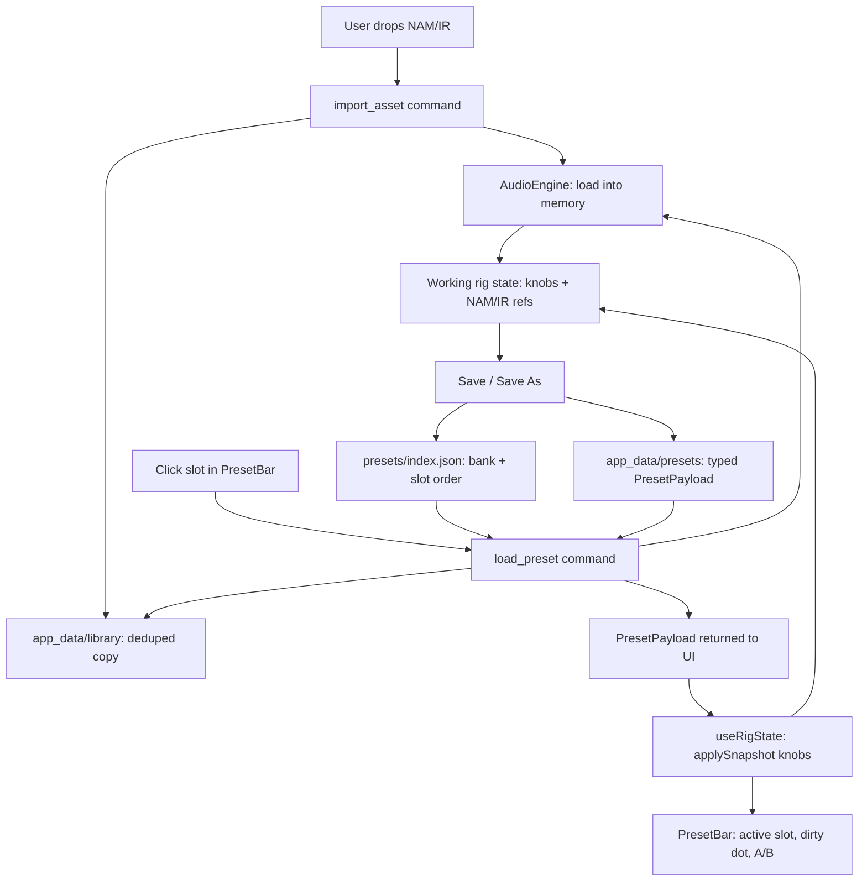

# DSP-Style Preset Manager for NAMpli

# Requirements

### Overview
Add a preset manager with the interaction model of a regular DSP rig: a row of footswitch-like
slots in banks, each recalling a **preset that holds exactly three things**:

1. **Knob state** — the six front-panel knob values from `AmpSettings`: Input, Gate, Bass, Middle,
   Treble, Output (0–10).
2. **NAM** — a reference to a stored `.nam` model file (or `null` = bypass).
3. **IR** — a reference to a stored `.wav` cabinet impulse response (or `null` = no cabinet).

Presets persist across restarts. Because the app currently loads dropped NAM/IR files into memory
only, the backend gains a small local asset library: a dropped file is still loaded immediately,
but a copy is also stored so the preset can recall it later. The app still starts in bypass mode.

### Goals
- Two banks (A and B) of four slots each (8 presets) in the main panel header.
- Click a slot to recall its knobs, NAM and IR; active slot highlighted; unsaved changes show a dirty marker.
- Save / Save As / Rename / Delete / Clear a slot; optional A/B compare.
- Presets survive application restarts, including the NAM and IR files they reference.
- Drag-and-drop remains the fastest audition path: a drop becomes unsaved working state that can be
  written to a slot with one click.
- Keep the existing brass/brown amp-panel theme and fixed 1200×650 window.

### In Scope
- **Frontend**: preset types, a rig-state hook (knobs + current NAM/IR), a preset-manager hook,
  a preset bar in `AmpPanel`, a small preset library modal, toasts, and the Tauri bridge.
- **Backend**: typed serde preset files under `app_data/presets/`, an ordered index, a local asset
  library under `app_data/library/`, asset import/dedupe, load-on-recall, rename/delete/export/import,
  and a bypass-capable model manager.
- **Migration**: tolerate the legacy raw-JSON preset blobs left by the removed implementation.

### Out of Scope
- **SettingsPanel values** — noise gate enable/threshold/decay, cabinet mix, buffer size,
  audio host/device selection — are global and **not** stored in presets. `SettingsPanel.tsx`
  is unchanged by this work.
- Power state, window state, MIDI footswitch control, cloud sync, factory preset packs.
- Reintroducing the deleted `InputJacks` model-switcher UI or loading built-in NAMs at startup.
- Changing DSP algorithms, the tuner, or audio-device enumeration.

### UX behaviour
- `PresetBar` sits in `.panel-header`, below the NAMpli title/subtitle:
  - Bank toggle `A | B`; four numbered slot buttons `1–4` per bank.
  - Each slot shows its name, or `Empty` when unused, plus the model name as a small caption.
  - Active slot: gold outline. Modified knobs or a changed NAM/IR since recall: a dirty dot `•`.
  - Right-click / long-press a slot: **Save**, **Save As…**, **Rename…**, **Delete**, **Clear**.
  - Buttons: **A/B** (compare) and **Library**.
- Clicking a slot calls `load_preset(name)`: the backend loads the stored NAM and IR into the engine
  and returns the payload; the frontend then applies the stored knob values through the existing
  setters so React state and the DSP stay in sync.
- Dropping a NAM or IR stores a copy in the library, loads it into the engine, updates the subtitle,
  and marks the current slot dirty. The existing "Load NAM model?" confirmation dialog is kept.
- `Save` overwrites the selected slot (confirm when dirty); `Save As…` asks for a name and target slot.
- `A/B` stores the current working snapshot in memory, recalls the other slot, and toggles back
  without writing to disk.
- All actions produce a toast via `notifications.ts`; deletes/overwrites ask for confirmation.

# Technical Design

### Current Implementation
- **`src-tauri/src/commands.rs:314–378`** — `list_presets`, `save_preset`, `load_preset`,
  `delete_preset` still exist and are registered in `lib.rs:56–59`, but they read/write a **raw JSON
  string blob** to `app_data/presets/<name>.json`. No typed payload, metadata, ordering, or rename,
  and `load_preset` does not change any audio state.
- **`src-tauri/src/commands.rs:429`** — `load_nam_from_path` already reloads a NAM from disk.
- **`src-tauri/src/commands.rs:446`** — `save_ir_file` already copies IRs to `app_data/irs/`.
- **`src-tauri/src/model_manager.rs`** — starts empty, supports byte loading, crossfades and bypass,
  but has **no way to clear the active model** (needed when recalling a preset with no NAM).
- **`src-tauri/src/audio_engine.rs`** — all knob setters exist; `AudioStatus` exposes only display
  names (`nam_model`, `ir_name`), not stable asset ids.
- **`src/App.tsx`** — owns drag-and-drop and dispatches `load-unnamed-nam` / `load-unnamed-ir`
  window events; `useAmpSettings.ts` owns the six knob values plus power.
- **`src/components/AmpPanel.tsx`** — listens for those events to show the subtitle; currently no
  preset UI. **`SettingsPanel.tsx` owns gate/IR-mix/buffer state locally and is left untouched.**

### Key Decisions
1. **Payload is intentionally small.** A preset stores knobs, NAM ref and IR ref (plus name, bank,
   slot, schema version, timestamp). No gate section, no IR mix, no buffer size, no power.
2. **A local asset library is required** for the preset to "hold NAM and IR" across restarts.
   Imported bytes are copied to `app_data/library/nams/` and `/irs/` under a content-derived id
   (sha256 prefix + original extension); duplicate imports are deduped. Presets store
   `{ id, name }` references, so several presets can share one asset.
3. **Knob mapping stays in one place.** The 0–10 → backend scaling already lives in
   `useAmpSettings.ts` (e.g. `gate > 0` → `set_noise_gate(enabled, -80 + value*6, 120)`).
   `load_preset` loads NAM + IR and returns the payload; the frontend applies knobs through the
   existing setters instead of duplicating that math in Rust.
4. **Gate caveat (accepted).** The front-panel Gate knob drives the same backend noise gate as the
   SettingsPanel gate controls. Recall pushes the knob value through; the SettingsPanel controls
   are global and may later override it, which is the app's existing behaviour. No new conflict.
5. **Dirty state is derived**, by comparing the current `RigSnapshot` (knobs + NAM/IR refs) with the
   active preset's `rig`; no backend flag.
6. **Bypass recall needs a new backend method.** A preset with `model: null` must clear the active
   model; `ModelManager` currently cannot do that.

### Data model (mirrored in `src/types/preset.ts` and `commands.rs`)
```ts
type Bank = 'A' | 'B';

interface AssetRef {
  id: string;   // relative library id, e.g. "nams/3f9a1c.nam"
  name: string; // display name, e.g. "JCM800 Hi P6 B8 M4 T7 G2.nam"
}

/** Exactly what a preset captures. */
interface RigSnapshot {
  inputVolume: number;  // 0-10
  gate: number;         // 0-10 (front-panel knob)
  bass: number;         // 0-10
  middle: number;       // 0-10
  treble: number;       // 0-10
  outputVolume: number; // 0-10
  model: AssetRef | null; // null = bypass
  ir: AssetRef | null;    // null = no cabinet
}

interface PresetPayload {
  schemaVersion: 1;
  name: string;
  bank: Bank;
  slot: 1 | 2 | 3 | 4;
  updatedAt: string;       // RFC 3339
  rig: RigSnapshot;
}

interface PresetMeta {
  name: string; bank: Bank; slot: number;
  modelName: string | null; irName: string | null; updatedAt: string;
}
```

### Architecture Diagram


### Proposed Changes

**Backend — `src-tauri/Cargo.toml`**
- Add `sha2 = "0.10"` for stable content-addressed ids (`DefaultHasher` is not stable across Rust
  releases; a persisted counter is the fallback if a new dependency is unwanted).

**Backend — `src-tauri/src/commands.rs`**
- Define serde `PresetPayload`, `RigSnapshot`, `AssetRef`, `PresetMeta`, `Bank` with camelCase rename
  and `#[serde(default)]` on fields for legacy tolerance.
- Replace the four raw-string preset commands with:
  - `list_presets() -> Vec<PresetMeta>` — reads `index.json`; falls back to scanning `*.json` and
    migrating legacy blobs on first run.
  - `save_preset(preset: PresetPayload) -> Result<(), String>` — validates name/bank/slot, writes the
    JSON file, updates the index.
  - `load_preset(name: String) -> Result<PresetPayload, String>` — resolves the stored asset ids
    under `app_data/library/`, loads NAM via `load_nam_from_path` (or `clear_nam` when `model` is
    null) and IR via `load_ir` (or `clear_ir` when `ir` is null), then **returns the payload**;
    knob application is done by the frontend.
  - `delete_preset`, `rename_preset`, `export_preset -> String`,
    `import_preset(json: String) -> PresetMeta`.
  - Keep `presets_dir` / `sanitize_preset_name`; add `library_dir(kind)` and a sha256-deduping
    `store_asset_bytes` helper.
- Add `import_asset(kind: 'nam' | 'ir', filename: String, path: Option<String>, data: Option<String>)
  -> AssetRef` — reads from a native-drop path or base64 browser fallback, stores a deduped library
  copy, and loads it into the engine through the existing loaders. Keep `load_nam_from_bytes`,
  `load_nam_from_path` and `save_ir_file` for compatibility; the frontend switches to `import_asset`.

**Backend — `src-tauri/src/model_manager.rs` / `audio_engine.rs`**
- Add `ModelManager::clear_current()` (clear `current_key`, fade and pending switch; keep cached
  models) and `AudioEngine::clear_nam()` for presets with no NAM. No other DSP changes.

**Backend — `src-tauri/src/lib.rs`**
- Register the new/changed commands in `generate_handler!`; remove the old raw-string signatures.

**Frontend — `src/types/preset.ts` (new)**
- `AssetRef`, `RigSnapshot`, `PresetPayload`, `PresetMeta`, `Bank`, `SLOTS_PER_BANK`, slot helpers.

**Frontend — `src/tauri.ts`**
- Replace raw-string preset functions with typed ones (`listPresets(): Promise<PresetMeta[]>`,
  `savePreset(preset: PresetPayload)`, `loadPreset(name): Promise<PresetPayload>`, …).
- Add `renamePreset`, `exportPreset`, `importPreset`, `importAsset`, and the `AssetRef` interface.

**Frontend — `src/hooks/useRigState.ts` (replaces `useAmpSettings.ts`)**
- Same six knob setters + `togglePower` as today, plus `model: AssetRef | null` and
  `ir: AssetRef | null` (fed by `importAsset`, replacing the custom window events).
- Expose `snapshot(): RigSnapshot` and `applySnapshot(snapshot: RigSnapshot): void`, which updates
  React state and pushes the six knob values through the existing Tauri setters exactly once.
- Power is deliberately excluded from snapshots.

**Frontend — `src/hooks/usePresetManager.ts` (new)**
- Loads `listPresets()` on mount; holds `activeBank`, `activeSlot`, `metas`, `dirty`, `isComparing`.
- Actions: `recall`, `save`, `saveAs`, `rename`, `remove`, `clear`, `compare`, `importJson`, `exportJson`.
- `recall` calls `loadPreset`, then `applySnapshot(payload.rig)`; `dirty` is a deep comparison of the
  current snapshot against the active preset's `rig`. Toasts via `notifications.ts`.

**Frontend — components**
- `src/components/PresetBar.tsx` + `.css` (new): bank toggle, four slot buttons, Save / A-B / Library,
  context menu with click-outside and Escape handling; existing gold/dark palette.
- `src/components/PresetLibrary.tsx` + `.css` (new): modal listing presets with bank/slot, name,
  model and IR; rename, delete, export/import JSON, close (reuse `.settings-overlay` styles).
- `src/components/AmpPanel.tsx`: render `<PresetBar>` in `.panel-header`; knobs already arrive as
  props — remove the `load-unnamed-*` event listeners once rig state holds the asset refs.
- `src/App.tsx`: instantiate `useRigState` + `usePresetManager`; route drops through `importAsset`
  and feed the returned refs into rig state (marking dirty); render the library modal; pass props.
- `src/App.css` / `AmpPanel.css`: small layout adjustments so the bar fits the 650px window.
- **`src/components/SettingsPanel.tsx`: no changes.**

### Delivery Steps

- [ ] **Step 1 — Backend storage foundation.** Serde preset/asset types, `index.json`, library dirs,
      sha256 dedupe, legacy migration; typed `list/save/delete/rename/export/import` commands
      registered in `lib.rs`. Verify `cargo check` in `src-tauri/`.

- [ ] **Step 2 — Backend recall + imports.** Add `clear_nam` / `ModelManager::clear_current`, make
      `load_preset` load NAM + IR and return the payload, add `import_asset`. Add Rust tests for
      preset round-trip, legacy migration, asset dedupe and bypass recall.

- [ ] **Step 3 — Frontend bridge + rig state.** Update `tauri.ts` and `types/preset.ts`, replace
      `useAmpSettings` with `useRigState` carrying knobs + NAM/IR refs. Verify `npx tsc --noEmit`
      and `npm run lint`.

- [ ] **Step 4 — Preset bar.** Implement `usePresetManager` and `PresetBar`: dirty tracking,
      save / save-as / delete / clear, A/B compare, toasts. Wire into `AmpPanel` and `App`.

- [ ] **Step 5 — Library modal.** Rename/delete plus JSON export via the dialog save picker and
      import via the open picker.

- [ ] **Step 6 — Drag-and-drop integration.** Switch `App.tsx` to `importAsset`; dropped files enter
      unsaved working state; subtitle and dirty marker update; NAM confirmation dialog preserved.

- [ ] **Step 7 — Polish and QA.** Style bar/modal/menu to match the brass theme; add a short README
      section. Manual checklist: save → restart → recall; knobs + NAM + IR restored; preset with no
      NAM returns to bypass; dirty dot clears on save; A/B compare writes nothing; rename/delete keep
      slot order; import/export round-trip; no audio glitch on recall.

### Open decisions (resolve during implementation)
- Bank count: 2 × 4 slots for v1; the data model supports adding C and D later.
- Keep A/B compare in v1 or defer it.
- Ship a few factory presets built from the bundled `public/models/gain*.nam` files.
- Prune unreferenced library assets ("Clean up library") in a later version.
