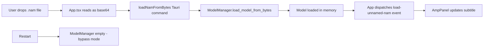

# Requirements

### Overview
Remove all reading of NAM models from the `nams` folder at startup. The app should start with no model loaded (bypass mode). The only way to load a NAM model is by dragging and dropping a `.nam` file into the window. Loaded models are kept in memory only — they do not persist across restarts.

### Goals
- No NAM models are loaded from disk at startup.
- The app starts in bypass mode (no model).
- Dropping a `.nam` file loads it into memory immediately.
- No NAM files are saved to disk when dropped.
- On restart, no model is loaded — the user must drop a file again.
- The Input knob remains as an input gain control (scaling signal into the model), not a model switcher.
- Keep IR drag-and-drop working (IRs can still be loaded via Settings or drag-and-drop).
- Keep all other settings (audio, cabinet, noise gate) intact.

### In Scope
- **Rust backend**: Remove `ModelManager::new(nams_dir)` which loads 10 built-in NAMs. Create an empty `ModelManager` instead. Remove `save_nam_file_unnamed` (no disk save). Replace `load_nam_by_path` with `load_nam_from_bytes` (parse from memory). Remove `list_nam_models` and `set_nam_model` commands. Remove `set_gain_level` and `set_sensitivity` model-switching commands (gain becomes input trim only).
- **Rust backend**: Update `AudioEngine` so `set_gain_level` adjusts input trim (`preamp`) instead of switching models. Remove `set_sensitivity` entirely.
- **Frontend**: Change drag-and-drop flow in `App.tsx` to send base64 bytes directly to the backend for in-memory loading instead of saving to disk then loading by path.
- **Frontend**: Remove `saveNamFileUnnamed` and `loadNamByPath` from `tauri.ts`. Add `loadNamFromBytes`.
- **Frontend**: Remove `setGainLevel` and `setSensitivity` from `tauri.ts` (unused in frontend already).
- **Frontend**: Remove `InputJacks.tsx` and `InputJacks.css` (dead code, never imported).
- Clean up `lib.rs` to remove `nams_dir` lookup.

### Out of Scope
- Removing the `nams/` folder from the project directory (it can remain as an artifact).
- Backend Rust preset commands (already dead code from previous cleanup).
- IR persistence changes (IRs loaded via Settings dialog still use `load_ir` which reads from a user-selected path).

# Technical Design

### Current Implementation

**Backend (Rust):**
- `lib.rs` — On startup, resolves a `nams` directory (`../nams` in debug, `resource_dir/nams` in release) and passes it to `ModelManager::new()`.
- `model_manager.rs` — `ModelManager::new(nams_dir)` loads 10 hardcoded NAM files from disk. It also supports `load_model_from_bytes()` for custom NAMs and `switch_model()` for built-in model switching by sensitivity+gain.
- `commands.rs` — `save_nam_file_unnamed` saves dropped NAM files to `app_data/nams/`. `load_nam_by_path` reads a saved file and loads it into the model manager. `set_gain_level` and `set_sensitivity` switch between preloaded built-in models. `list_nam_models` returns model names.
- `audio_engine.rs` — `set_gain_level` calls `model_manager.switch_model()`. `set_sensitivity` does the same. The DSP worker uses `preamp` for input trim (already implemented).

**Frontend:**
- `App.tsx` — Drag-and-drop reads the file as base64, calls `saveNamFileUnnamed` to save to disk, then dispatches `load-unnamed-nam` with the file path. The backend's `load_nam_by_path` is called elsewhere.
- `AmpPanel.tsx` — Listens for `load-unnamed-nam` events and updates the displayed model name.
- `tauri.ts` — Exports `saveNamFileUnnamed`, `loadNamByPath`, `setGainLevel`, `setSensitivity`.
- `InputJacks.tsx` — Exists but is never imported (dead code).

### Key Decisions
- **ModelManager starts empty**: Instead of loading 10 NAMs at startup, `ModelManager::new()` takes no arguments and creates an empty model map. The DSP worker must handle the case where no model is loaded (pass-through / bypass).
- **In-memory NAM loading**: A new `load_nam_from_bytes` Tauri command replaces the save-then-load pattern. The frontend sends base64 data directly; the backend parses and loads the model into memory. No file is written to disk.
- **Gain as input trim only**: `set_gain_level` in the backend will adjust the `preamp` field in `SharedState` (input trim, already used in the DSP worker) instead of switching models. The `set_sensitivity` command is removed entirely. The frontend already doesn't call these commands.
- **Bypass mode in DSP**: When no model is loaded, the DSP worker passes the input signal through unchanged (identity processing). The `ModelManager::process()` method needs to handle an empty model gracefully.

### Proposed Changes

**`src-tauri/src/lib.rs`:**
- Remove `nams_dir` resolution (debug/release path logic).
- Change `ModelManager::new(&nams_dir)` to `ModelManager::new()` (no argument).
- Remove `commands::list_nam_models` and `commands::set_nam_model` from the invoke handler.
- Remove `commands::save_nam_file_unnamed` and `commands::load_nam_by_path` from the invoke handler.
- Add `commands::load_nam_from_bytes` to the invoke handler.
- Remove `commands::set_gain_level` and `commands::set_sensitivity` from the invoke handler (or keep as no-ops for input trim).

**`src-tauri/src/model_manager.rs`:**
- Change `ModelManager::new(nams_dir: &Path)` to `ModelManager::new()` — no file loading, empty HashMap.
- Remove `BuiltIn` variant from `ModelId` enum (only `Custom` remains for dropped files).
- Remove `switch_model()`, `switch_model_index()`, and `model_names()` methods (no built-in models).
- Update `process()` to handle the case where no model is loaded — pass buffer through unchanged.
- Keep `load_model_from_bytes()` and `switch_model_by_key()` for custom NAMs.
- Remove `Sensitivity` and `GainLevel` types and `ModelKey` struct (no longer needed for model switching).

**`src-tauri/src/commands.rs`:**
- Remove `save_nam_file_unnamed` command.
- Remove `load_nam_by_path` command.
- Add `load_nam_from_bytes(filename: String, data: String)` command that decodes base64, calls `model_manager.load_model_from_bytes()`, then switches to that model.
- Remove `list_nam_models` and `set_nam_model` commands.
- Remove `set_gain_level` and `set_sensitivity` commands (or repurpose `set_gain_level` to adjust `preamp` only).

**`src-tauri/src/audio_engine.rs`:**
- Remove `set_gain_level()` method (or change it to adjust `preamp` only, no model switching).
- Remove `set_sensitivity()` method.
- Remove `set_nam_model()` method.
- Remove `nam_model_name()` and `nam_model_names()` methods.
- Remove `load_nam_by_path()` method.
- Remove `sensitivity` and `gain_level` fields from `SharedState` (or keep `gain_level` if repurposed for input trim).
- Update `AudioStatus` to remove `nam_model` field (or keep it for the current custom model name).

**`src/App.tsx`:**
- Change `handleDroppedFile` for `.nam` files: instead of calling `saveNamFileUnnamed` and dispatching an event, call a new `loadNamFromBytes` tauri function that returns the model name, then dispatch `load-unnamed-nam` with the model name.

**`src/tauri.ts`:**
- Remove `saveNamFileUnnamed`, `loadNamByPath`, `setGainLevel`, `setSensitivity`, `listNamModels`, `setNamModel`.
- Add `loadNamFromBytes(filename: string, data: string): Promise<string>`.

**`src/components/AmpPanel.tsx`:**
- Update `load-unnamed-nam` event handler to expect a model name string instead of a file path.

**Deleted files:**
- `src/components/InputJacks.tsx` (dead code, never imported)
- `src/components/InputJacks.css` (dead code)

### Architecture Diagram

# Delivery Steps

### ✓ Step 1: Remove preset carousel from AmpPanel
*(Completed in previous session)*

### ✓ Step 2: Remove preset support from SettingsPanel and tauri bridge
*(Completed in previous session)*

### * Step 3: Remove built-in NAM loading from Rust backend
ModelManager starts empty; no NAMs are loaded from disk at startup. The DSP worker handles bypass mode.
- Change `ModelManager::new(nams_dir: &Path)` to `ModelManager::new()` with no arguments in `model_manager.rs`.
- Remove the 10 hardcoded NAM file mappings and the file loading loop.
- Remove `BuiltIn` variant from `ModelId` enum; keep only `Custom(String)` for dropped files.
- Remove `Sensitivity`, `GainLevel`, and `ModelKey` types from `model_manager.rs`.
- Remove `switch_model()`, `switch_model_index()`, `model_names()`, and `sorted_ids()` methods.
- Update `process()` to pass the buffer through unchanged when no model is loaded (bypass).
- Update `lib.rs` to remove `nams_dir` resolution and pass no argument to `ModelManager::new()`.
- Remove `set_gain_level`, `set_sensitivity`, `list_nam_models`, and `set_nam_model` from `commands.rs` and the invoke handler in `lib.rs`.
- Remove `set_gain_level()`, `set_sensitivity()`, `set_nam_model()`, `nam_model_name()`, `nam_model_names()`, and `load_nam_by_path()` from `audio_engine.rs`.
- Remove `sensitivity` and `gain_level` fields from `SharedState` in `audio_engine.rs`.

### ✓ Step 4: Replace save-then-load with in-memory NAM loading
Dropped NAM files are parsed directly from base64 bytes into memory without saving to disk.
- Add `load_nam_from_bytes(filename: String, data: String)` command in `commands.rs` that decodes base64, calls `model_manager.load_model_from_bytes()`, switches to the model, and returns the model name.
- Remove `save_nam_file_unnamed` and `load_nam_by_path` commands from `commands.rs`.
- Update the invoke handler in `lib.rs` to register `load_nam_from_bytes` and remove the old commands.
- Add `loadNamFromBytes` to `tauri.ts` (frontend bridge).
- Remove `saveNamFileUnnamed` and `loadNamByPath` from `tauri.ts`.
- Update `App.tsx` `handleDroppedFile`: for `.nam` files, call `loadNamFromBytes` instead of `saveNamFileUnnamed`, and dispatch `load-unnamed-nam` with the returned model name (not a path).
- Update `AmpPanel.tsx` event handler to use the model name directly instead of extracting it from a file path.

### ✓ Step 5: Clean up dead code and verify
Remove unused frontend files and verify the build.
- Delete `src/components/InputJacks.tsx` and `src/components/InputJacks.css` (never imported).
- Remove `setGainLevel` and `setSensitivity` from `tauri.ts` (already unused in frontend).
- Run `npx tsc --noEmit` to verify TypeScript compilation.
- Verify Rust compilation (`cargo check` in `src-tauri/`).