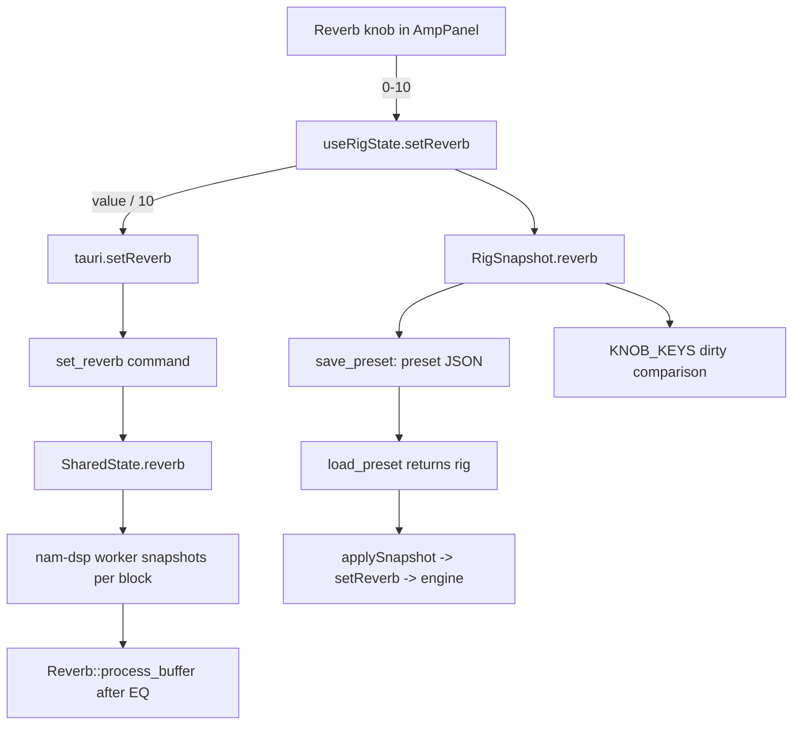

# Reverb as a Front-Panel Knob for NAMpli

# Requirements

### Overview
Add a **Reverb** knob to the amp faceplate (0–10, default `0` = off) that applies an algorithmic
room reverb to the guitar signal. Like the other front-panel knobs, its value is part of the rig
state: it is saved in presets, recalled with them, included in the unsaved-changes (dirty) marker,
and pushed to the audio engine through a new Tauri command. The app keeps starting with no reverb,
so the existing sound is unchanged until the user turns the knob.

### Goals
- A `Reverb` knob rendered in `AmpPanel` with the same look and interactions as the existing knobs.
- Reverb DSP in the Rust audio engine, running on the existing DSP worker thread with no extra
  allocation in the audio callbacks.
- Turning the knob from 0 changes the sound immediately while audio is running; no clicks, no
  stream restart.
- Reverb value travels through the whole rig-state pipeline: `AmpSettings` → `RigSnapshot` →
  preset files (older presets load with reverb off) → A/B compare → dirty tracking.
- Keep the brass/brown amp theme, the fixed window layout, and the current bypass-by-default
  startup behaviour.

### In Scope
- **Backend**: a small self-contained reverb DSP module (no new crates), a `set_reverb` command,
  engine state, and the new preset field with legacy defaults.
- **Frontend**: the knob UI, rig-state setter, Tauri bridge, preset type additions, dirty-key update,
  and README updates.

### Out of Scope
- Convolution reverb driven by a dropped/imported IR file, or an IR asset library for reverb.
- Additional reverb controls (room size, damping, pre-delay, stereo width) on the panel or in
  Settings — v1 is a single wet/mix knob with fixed voicing.
- Changing the NAM model, cabinet IR, noise gate, EQ, tuner, device enumeration, or preset file
  format beyond one optional field.

### UX behaviour
- The knob sits in the output knob group next to `Output`, labelled `Reverb`, 0–10 like every other
  knob (`Knob` already handles drag, touch, ticks and the `title` tooltip).
- `0` = no reverb; higher values increase the wet mix up to a musical maximum (recommended
  `value / 10 * 0.5` wet, never 100%, so the dry guitar stays present).
- Tooltip: "Room reverb. 0 = off."
- Recalling a preset restores its reverb value through the same `applySnapshot` path as the other
  knobs; a changed reverb value marks the active slot dirty via `usePresetManager`.

# Technical Design

### Current Implementation
- **`src-tauri/src/audio_engine.rs:79–129`** — `SharedState` holds every live DSP parameter
  (`bass`, `middle`, `treble`, `presence`, `preamp`, `master_volume`, `gate_*`, `ir_mix`, …) with
  `0..1` ranges and defaults in `new()`. No reverb field exists.
- **`src-tauri/src/audio_engine.rs:392–566`** — the `nam-dsp` worker thread creates its DSP state once
  per stream (`EqChain`, `Tuner`, smoothing coefficients, DC blocker), snapshots UI parameters once
  per block, and processes: tuner → trim/gate → NAM → cabinet IR → loudness → EQ → smoothed master
  gain → DC blocker + soft clip → output ring. This is the insertion point for reverb.
- **`src-tauri/src/audio_engine.rs:674–743`** — knob setters clamp to `0..1` and only lock
  `SharedState`; no stream restart is involved.
- **`src-tauri/src/commands.rs:185–255`** — one `#[tauri::command]` per knob setter; registered in
  **`src-tauri/src/lib.rs:36–72`**.
- **`src-tauri/src/commands.rs:349–383`** — `RigSnapshot` is the preset-captured state; its fields
  use `#[serde(default = "default_knob")]` (knobs) / `#[serde(default)]` for forward-compatible
  loading. `parse_preset_json` (`:537`) also migrates legacy flat blobs into this struct.
- **`src/types/amp.ts`** — `AmpSettings` has the six knob values + `powerOn`; `DEFAULT_SETTINGS`
  supplies their defaults.
- **`src/hooks/useRigState.ts`** — owns `AmpSettings`; each setter updates React state then calls
  the Tauri setter with `value / 10` scaling, and `snapshot()` / `applySnapshot()` move all knobs
  in/out of presets.
- **`src/hooks/usePresetManager.ts:23–44`** — `KNOB_KEYS` drives dirty detection and must be kept in
  sync with any new knob.
- **`src/components/AmpPanel.tsx:62–105`** — three `.knob-group`s of `<Knob>`s; props are passed
  explicitly from **`src/App.tsx:284–303`**.
- **`src/components/Knob.tsx`** — generic 0–10 knob; no changes needed.
- **`src-tauri/Cargo.toml`** — no audio effect libraries; the cabinet convolver in
  **`src-tauri/src/ir.rs`** is hand-written, establishing the precedent for DSP in-module.
  Earlier planning docs already list "Effects chain (reverb, delay, etc.)" as future work.

### Key Decisions
1. **Algorithmic reverb, not convolution.** A Freeverb-style network (8 parallel comb filters +
   4 series allpass filters, delays scaled by sample rate) is self-contained, cheap, and needs no
   IR asset or new dependency. A single mix knob is enough to expose it. Convolution reverb would
   require shipping an IR and an asset workflow, which is out of scope.
2. **Preset-captured, not global.** Reverb is a front-panel knob like Output/Gate, so it belongs in
   `RigSnapshot` and is recalled, compared (A/B), and dirty-tracked with the rest of the rig.
   Settings-panel values (cab mix, buffer size, devices) stay global and untouched.
3. **One knob = wet mix only.** Room size and damping stay fixed at musical defaults. This avoids
   a settings UI and keeps recall deterministic. They can be exposed later without changing the
   preset format (store defaults now, add optional fields later).
4. **No schema version bump.** `RigSnapshot.reverb` is added with `#[serde(default = "zero")]`, so
   existing preset JSON files deserialize with reverb off. Keep `schemaVersion: 1`; the format stays
   backward- and forward-compatible.
5. **Insert after the EQ, before the master-gain/limiter stage.** The reverb sees the final amp tone
   at a known level, loudness normalization is unaffected, and the existing soft clip still guards
   the output. Processing the tail before the cabinet IR is a valid alternative but changes how the
   IR colours the tail — see Open decisions.
6. **Smooth the wet/dry gain, skip work at zero.** Mix changes are smoothed per sample (~5 ms, using
   the worker's existing smoothing approach) so knob turns do not click. When the smoothed mix has
   settled at zero, `process_buffer` short-circuits so an unused reverb costs nothing. Filter state
   lives in the worker thread created at stream start and is discarded on stop, like `EqChain`.
7. **Keep the pipeline mono.** The output callback duplicates one mono stream to all channels (see
   `audio_engine.rs:570–584`), so reverb is mono to match; stereo widening would require changing
   the output path and is deferred.
8. **Knob scaling stays in the frontend.** The UI sends 0..1 (`value / 10`) to `set_reverb`, matching
   every other knob; Rust only clamps and stores it.

### Data model (mirrored in `src/types/preset.ts` and `commands.rs`)
```ts
// Added to AmpSettings (UI state, 0-10):
reverb: number;   // 0 = off, 10 = maximum wet mix

// Added to RigSnapshot (preset-captured, 0-10):
reverb: number;   // #[serde(default = "zero")] on the Rust side

// New Tauri command:
set_reverb(value: f32)  // value in 0..1, clamped in AudioEngine
```

### Architecture Diagram


### Proposed Changes

**Backend — `src-tauri/src/reverb.rs` (new)**
- `pub struct Reverb` built from comb/allpass delay lines sized from the sample rate
  (`delay_len = round(base_delay_ms * sample_rate / 1000)`), allocated once in `new()`.
- Comb filters: delay ~29.7–50 ms, feedback ~0.77–0.84, fixed low-pass damping (~0.2) in the
  feedback path; allpass filters: ~5 ms and ~1.7 ms with ~0.5 gain. Standard Freeverb values,
  scaled to the runtime sample rate.
- `pub fn process_buffer(&mut self, buffer: &mut [f32], mix: f32)`:
  - smooth an internal `wet` gain toward `mix` per sample (~5 ms);
  - when both target and current wet are ~0, return early (bypass);
  - otherwise copy the input into a preallocated scratch buffer, run the comb/allpass network to
    produce wet samples, and write `dry * (1 - wet) + wet_sample * wet` back into `buffer`.
- Unit tests: zero mix leaves the buffer bit-for-bit unchanged; an impulse produces a decaying tail
  (energy at sample 0 > energy after ~0.5 s); no NaNs and bounded output for a full-scale buffer.

**Backend — `src-tauri/src/audio_engine.rs`**
- `mod reverb` import; `SharedState.reverb: f32` (0..1) with default `0.0` in `new()`.
- Add `reverb` to the per-block parameter snapshot tuple in the worker and construct
  `let mut reverb = Reverb::new(sample_rate);` alongside `EqChain`/`Tuner`.
- Call `reverb.process_buffer(&mut buffer[..got], reverb_mix);` after `eq.process(...)` and before the
  master-gain/DC-block/soft-clip loop.
- `pub fn set_reverb(&self, value: f32)` — clamp to `0..1`, store, log (mirrors `set_ir_mix`).

**Backend — `src-tauri/src/commands.rs`**
- Add `#[tauri::command] pub fn set_reverb(engine: State<'_, StdMutex<AudioEngine>>, value: f32) -> Result<(), String>`.
- Add `#[serde(default = "zero")] pub reverb: f32` to `RigSnapshot`, to its `Default` impl (`0.0`),
  and `reverb: 0.0` in the legacy-migration constructor in `parse_preset_json`.
- Extend the `preset_round_trip` test with a nonzero reverb value; add a test that a preset JSON
  without `reverb` parses to `0.0`.

**Backend — `src-tauri/src/lib.rs`**
- Add `mod reverb;` and register `commands::set_reverb` in `generate_handler!`.

**Frontend — `src/types/amp.ts`**
- `reverb: number` in `AmpSettings`; `reverb: 0` in `DEFAULT_SETTINGS`.

**Frontend — `src/types/preset.ts`**
- `reverb: number` in `RigSnapshot` and `reverb: 0` in `DEFAULT_RIG`; update the comment that lists
  the captured knobs.

**Frontend — `src/tauri.ts`**
- `export async function setReverb(value: number): Promise<void> { return invoke('set_reverb', { value }); }`.

**Frontend — `src/hooks/useRigState.ts`**
- Import `setReverb as tauriSetReverb`; add a `setReverb` callback (React state + `value / 10`
  scaling + error toast), include it in `snapshot()` and `applySnapshot()` and in the returned
  object/dependency lists.

**Frontend — `src/hooks/usePresetManager.ts`**
- Add `'reverb'` to `KNOB_KEYS` so recall/save/compare and the dirty dot track it.

**Frontend — components**
- `src/components/AmpPanel.tsx`: add `reverb` and `onSetReverb` props and a
  `<Knob label="Reverb" value={reverb} onChange={onSetReverb} description="Room reverb. 0 = off." />`
  in the output group (after `Output`).
- `src/App.tsx`: destructure `setReverb` from `rig`, pass `reverb={settings.reverb}` and
  `onSetReverb={setReverb}` to `<AmpPanel>`.
- `src/components/SettingsPanel.tsx`: optional — add `onSetReverb` to its props for consistency; it
  currently ignores all knob setters, so no functional change is required.
- `src/components/Knob.tsx` / `Knob.css`: unchanged (generic 0–10 knob). `AmpPanel.css`: no change
  expected — `.knob-row` already wraps groups.

**Docs — `README.md`**
- Mention the Reverb knob among front-panel controls and that it is stored in presets; keep the note
  that cab mix / buffer / device settings remain global.

### Delivery Steps

- [ ] **Step 1 — Reverb DSP module.** Add `reverb.rs` with the comb/allpass network, smoothed mix,
      zero-mix bypass and unit tests. Verify `cargo test -p app`.
- [ ] **Step 2 — Engine + command wiring.** Add `SharedState.reverb`, the worker instance and
      processing call, `set_reverb`, the Tauri command and its `lib.rs` registration. Verify
      `cargo check` in `src-tauri/`.
- [ ] **Step 3 — Preset field.** Add `reverb` to `RigSnapshot` with serde defaults, legacy migration
      and tests; confirm old preset JSON still loads with reverb off.
- [ ] **Step 4 — Frontend state + bridge.** Add the `AmpSettings`/`RigSnapshot` field, `setReverb`
      bridge function, `useRigState` setter and `KNOB_KEYS` entry. Verify `npx tsc --noEmit` and
      `npm run lint`.
- [ ] **Step 5 — UI.** Render the Reverb knob in `AmpPanel`, pass props from `App`, check the layout
      at the fixed window size.
- [ ] **Step 6 — QA + docs.** Update README. Manual checklist: knob 0 → 10 is audible and smooth;
      no click on fast knob turns; turning to 0 fully removes the tail; save preset with reverb →
      restart → recall restores it; old presets recall with reverb at 0; reverb change flips the
      dirty dot; A/B compare swaps reverb correctly; audio power cycle and NAM/IR changes still work.

### Open decisions (resolve during implementation)
- **Wet curve**: recommended `value / 10 * 0.5`; tune by ear after the first listen. `0` must remain
  exact bypass.
- **Insertion point**: after EQ (recommended, simplest and level-stable) vs. before the cabinet IR
  (the cab would also colour the reverb tail, at the cost of feeding the tail through the convolver).
- **Voicing**: fixed Freeverb room/damping vs. a slightly shorter, darker "room" more typical of
  guitar amps. Fixed values now; expose extra knobs only if requested later.
- **Mono vs. stereo**: mono matches the current output path; stereo would need output-pipeline work.
- **`value / 10` scaling** mirrors existing knobs; if the wet curve is later changed to be
  non-linear, keep the mapping in `useRigState.setReverb` so presets stay 0–10 integers.
