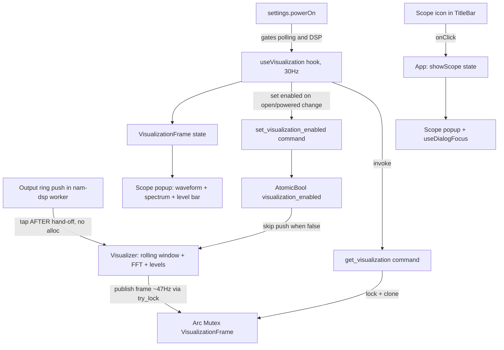

# Sound Visualization for NAMpli

# Requirements

### Overview
Add a **Scope** panel that visualizes the sound coming out of the amp in real time. It shows an
oscilloscope-style waveform (time domain), an FFT spectrum analyser (frequency domain), and a compact
RMS/peak level meter. The panel opens from a new title-bar button, the same way the Tuner popup does.
While it is closed or the amp is off, both the analysis and the polling are switched off at source —
the feature has zero DSP and IPC cost in that state.

The signal visualized is the **processed output** — the exact mono samples the output callback sends
to the audio device (post NAM, IR, EQ, reverb, gain and limiter) — so what you see matches what you
hear and the EQ/reverb knobs visibly change the picture.

### Goals
- See the waveform and the frequency content of the guitar signal live while playing.
- Make the existing tone controls tangible: turning Bass/Middle/Treble/Presence or Reverb visibly
  changes the spectrum without any extra UI wiring.
- Reuse the established architecture: analysis on the existing `nam-dsp` worker thread, hand-written
  DSP with no new crates (precedent: `tuner.rs`, `ir.rs`), a Tauri command for transport, and a hook
  that polls only while the panel is visible.
- No allocation or locking in the audio callbacks, no stream restarts, no change to the sound, and
  no change to preset/rig state — this is a read-only tap on the signal.
- **Do not add a single sample of audio latency.** All analysis runs after the block has already been
  handed to the output ring, and is disabled at source when the Scope is closed. See
  [Latency & CPU safety](#latency--cpu-safety).

### In Scope
- **Backend**: a self-contained `visualizer` DSP module (rolling waveform buffer + radix-2 FFT +
  level detection), a snapshot store in the audio engine, and `get_visualization` /
  `set_visualization_enabled` commands.
- **Frontend**: a title-bar icon, a popup panel with two `<canvas>` displays and a level bar, a
  `getVisualization` bridge function, and a polling hook gated on `open && powered`.

### Out of Scope
- Recording, replay, screenshots/export, or persistent history/spectrogram waterfall.
- Analysing the raw input instead of the output, or an input/output A/B switch (possible later —
  see Open decisions).
- New dependencies (FFT crate, WebGL/three.js, charting library). Canvas 2D is enough.
- Changes to presets, knobs, rig state, tuner, devices, or the audio pipeline's sound.

### UX behaviour
- A **Scope** icon joins Settings and Tuner in the title bar. Clicking it opens a popup dialog with
  the same overlay/outside-click/Escape behaviour as the Tuner popup (`useDialogFocus`).
- The popup has a header (`Scope`, `48 kHz` / `—`), a waveform canvas on top, a spectrum canvas below
  it, and a thin RMS/peak level bar with a clip indicator at the top.
- While powered off (or before the first frame arrives) both canvases show a flat idle line and the
  header reads `Power on to see the signal`. No polling happens in that state.
- The waveform uses a simple rising zero-crossing trigger in the renderer so notes stay visually
  centred instead of scrolling sideways.
- On stream restart (power cycle, device/latency change) the analyser is reset and the display
  returns to idle within one poll interval.

# Technical Design

### Current Implementation
- **`src-tauri/src/audio_engine.rs:80–133`** — `SharedState` holds live DSP parameters plus the tuner
  result; the tuner writes `tuner_hz` / `tuner_level_db` into it. A separate `Arc<AudioHealth>` is
  used for independent, lock-light health data — the precedent for a separate snapshot store.
- **`src-tauri/src/audio_engine.rs:334–341`** — on `start()` the state's tuner fields are cleared and
  health is reset; this is where the visualizer must also be reset for the new sample rate.
- **`src-tauri/src/audio_engine.rs:394–579`** — the `nam-dsp` worker allocates its DSP state once
  (`EqChain`, `Reverb`, `Tuner`, …) and processes each block in place. The final samples are soft-clipped
  at `:568–575` and handed to the output ring at `:577`. The tap goes **after** that hand-off: call
  `visualizer.push(&buffer[..got])` only once `out_producer.push_slice(&buffer[..got])` has returned,
  so no visualization work sits on the critical path to the audio device.
- **`src-tauri/src/audio_engine.rs:802–806`** — `AudioEngine::tuner()` is the read accessor; the
  visualization accessor will mirror it.
- **`src-tauri/src/tuner.rs`** — pitch analysis on the worker thread, pre-allocated buffers, and the
  pattern "push samples, periodically return a reading". `ir.rs` shows hand-written DSP with no crates.
- **`src-tauri/src/commands.rs:309–323`** — `get_tuner` returns a `#[serde(rename_all = "camelCase")]`
  struct; `src-tauri/src/lib.rs:37–75` registers commands.
- **`src/tauri.ts:105–112`** — `getTuner()` bridge; **`src/components/Tuner.tsx:29–48`** polls it every
  120 ms only while powered. **`src/hooks/useAudioStatus.ts`** is the other polling hook.
- **`src/App.tsx:35, 49, 122, 239–256`** — `showTuner` state, `closeTuner`, `useDialogFocus`, and the
  tuner popup overlay: the exact pattern to copy for the Scope popup.
- **`src/components/TitleBar.tsx:70–76`** — the `.titlebar-tools` row holding Settings and Tuner icons;
  **`TunerIcon.tsx`** is the icon template.
- **`src/index.css:11–29`** — theme variables (`--gold`, `--bg-sunken`, `--ok`, `--danger`, …) for the
  display styling.

### Key Decisions
1. **Poll a snapshot, don't stream audio.** The frontend never sees raw sample streams: Rust reduces
   each block to a small, fixed-size snapshot (e.g. 1024 waveform floats + 64 spectrum bins + 2 level
   values). A `get_visualization` command polled at ~30 Hz (≈33 ms) is enough for a smooth display and
   reuses the proven tuner pattern. Tauri events / `Channel` are a documented upgrade path if 30 Hz
   looks choppy (see Open decisions).
2. **Read-only tap on the final output, after the ring hand-off.** Read the block after the limiter so
   the display represents audible signal and automatically reflects every effect, but call the
   visualizer *after* `out_producer.push_slice` (`:577`). The analysis never mutates the buffer, and
   even a slow FFT cannot delay the samples already handed to the output ring.
3. **All DSP on the existing worker thread.** No new thread, no new stream, no allocations in any
   callback. `Visualizer` owns its window/FFT/scratch buffers, allocated once per stream like
   `Tuner::new`. This keeps the audio deadline untouched.
4. **Separate snapshot lock.** Store the frame in an `Arc<Mutex<VisualizationFrame>>` on `AudioEngine`,
   alongside `health`, rather than inside `SharedState`. The worker only locks it when it publishes a
   new frame (~47 times a second), so the per-block parameter snapshot is unaffected.
5. **Hand-written radix-2 FFT, no new crate.** A 1024-point in-place FFT with Hann window and
   magnitudes folded into ~64 log-spaced bins (≈60 Hz–16 kHz) is ~50 lines and matches the project's
   "DSP in-module" precedent. Binning logarithmically makes bass detail visible on a guitar.
6. **Spectrum recomputed at ~50 Hz, waveform always freshest.** The waveform is simply the latest
   1024 samples (~21 ms at 48 kHz); the FFT runs when a full new window has accumulated. Publishing a
   frame every ~1024 samples (~21 ms) gives ~47 fps of new data while capping work per block.
7. **Rendering work stays in the browser.** Triggering, grid, scaling and colouring are done in the
   canvas draw loop (`requestAnimationFrame` + the latest polled frame), keeping Rust output simple
   normalized values.
8. **Zero cost when unused.** An `Arc<AtomicBool>` on `AudioEngine`, toggled by a
   `set_visualization_enabled` command from the polling hook, gates the worker's `visualizer.push()`.
   When the popup closes or power goes off, the hook flips the flag off and clears its frame: no FFT,
   no frame publish, no IPC, no canvas work. On the disabled→enabled transition the worker resets the
   visualizer's window so the first frame is not a mix of stale and live samples.
9. **No state/preset impact.** No rig-state field, no Tauri setter, no schema change (other than the
   read/write enable command above). Pure observation of the signal.

### Latency & CPU safety

The configured latency is unchanged: no extra buffers, no changes to the device period or
`latency_frames`, and no work added to either cpal callback. The only way visualization can affect
audio is **CPU contention on the `nam-dsp` worker**: if it falls behind, the output ring can run dry
(an xrun/glitch) and a growing input backlog drains over several blocks, temporarily *increasing*
effective latency. Mitigations:

1. **Tap after hand-off** — all visualization work happens after `out_producer.push_slice` has copied
   the block into the output ring, so this block's delivery is never delayed by an FFT.
2. **`try_lock()` publish** — if the UI happens to hold the frame lock, the worker drops that frame
   instead of blocking. The command's critical section is just a clone of a few hundred floats.
3. **Gated at source** — the `enabled` flag means users who keep the Scope closed run the exact code
   path they have today. Audio-critical sessions can simply leave it closed.
4. **Cheap by construction** — a 1024-point FFT with ~50k float operations every ~21 ms is tiny next
   to the tuner's existing YIN analysis (~3M operations every ~85 ms, `tuner.rs:120–145`). No new
   dependency or thread is involved.
5. **Measure in dev mode** — the app crate builds at `opt-level = 1` in dev (`Cargo.toml:24–25`),
   while dependencies use 3. Hand-written DSP lives in the app crate, so check xruns in
   `npm run tauri dev`, not only in a release build. The `AudioStatusBar` xrun counter is the signal
   to watch with the Scope open and closed.
6. **Optional refinement** — if a future profile still shows jitter, split `push()` into a cheap
   `push_samples()` (ring write only) and a due-only `analyze_and_publish()`, both after the ring
   push. No interface change for the frontend.

Note: the **display** lags the sound by up to one poll interval (~33 ms) plus a canvas frame
(~16 ms). That is visual latency only and never affects the audio.

### Data model

```ts
// src/tauri.ts
export interface VisualizationFrame {
  waveform: number[];   // latest 1024 output samples, -1..1
  spectrum: number[];   // ~64 log-spaced bins, 0..1 normalized dB
  levelDb: number;      // RMS of the current window, dBFS
  peakDb: number;       // peak of the current window, dBFS
}
export async function getVisualization(): Promise<VisualizationFrame | null>;

// Gate the DSP work at source; the hook calls this when open/powered changes.
export async function setVisualizationEnabled(enabled: boolean): Promise<void>;
```

```rust
// src-tauri/src/visualizer.rs
pub struct VisualizationFrame {
    pub waveform: Vec<f32>,   // matches the TS shape (camelCase anyway)
    pub spectrum: Vec<f32>,
    pub level_db: f32,
    pub peak_db: f32,
}
```

### Architecture Diagram


### Proposed Changes

**Backend — `src-tauri/src/visualizer.rs` (new)**
- Constants: `WAVE_SAMPLES = 1024`, `FFT_SIZE = 1024`, `BANDS = 64`,
  `MIN_HZ = 60.0`, `MAX_HZ = 16_000.0`.
- `pub struct Visualizer` with pre-allocated `wave: Vec<f32>` (ring), `fft_real`/`fft_im` buffers,
  a Hann window table, scratch for analysis, a write index, a sample counter, and `sample_rate`.
- `pub fn new(sample_rate: f32)` and `pub fn prepare(&mut self, sample_rate: f32)` (called after a
  sample-rate change; clears history and recomputes bin edges).
- `pub fn push(&mut self, samples: &[f32]) -> Option<VisualizationFrame>`: copy samples into the ring
  buffer (no allocation); update running RMS/peak; every `FFT_SIZE` new samples, apply the Hann
  window, run the in-place iterative radix-2 FFT, convert magnitudes to dB, fold them into log-spaced
  bands, normalize to 0..1 over a fixed dB range (e.g. −90..0 dBFS), and return a fresh frame whose
  `waveform` is the ring read oldest→newest. Called only after the output-ring hand-off and only while
  the enable flag is set (see Latency & CPU safety).
- Helpers: `fn fft(real: &mut [f32], imag: &mut [f32])` (bit-reversal + butterfly stages),
  `fn bin_ranges(sample_rate, fft_size) -> Vec<(usize, usize)>` for log spacing.
- Unit tests: a sine at ~440 Hz puts its energy in the expected band and nowhere near the top band;
  silence yields a zero spectrum and very low `levelDb`; white-ish input stays finite and bounded;
  `prepare()` clears history; waveform length is always `WAVE_SAMPLES`.

**Backend — `src-tauri/src/audio_engine.rs`**
- `mod visualizer` import; add `visualization: Arc<Mutex<Option<VisualizationFrame>>>` and
  `visualization_enabled: Arc<AtomicBool>` (default `false`) to `AudioEngine`, initialized in `new()`.
- Pass `Arc` clones of both into the worker. Construct `let mut visualizer =
  Visualizer::new(sample_rate);` alongside `Tuner::new`, and keep a local `was_enabled` bool to detect
  flag transitions.
- **After** `out_producer.push_slice(&buffer[..got])` (`:577`) — never before — check the flag: on
  disabled→enabled call `visualizer.prepare(sample_rate)`; while enabled call
  `visualizer.push(&buffer[..got])` and publish a returned frame with `try_lock()` (drop that frame if
  the UI holds the lock); on enabled→disabled clear the published frame to `None`. The buffer is still
  valid after the ring push, so the tap is a pure read at this point.
- Reset on stream start/stop: clear the published frame to `None` and recreate the worker's visualizer
  for the new sample rate, alongside the tuner reset in `start()` (`:334–341`).
- `pub fn set_visualization_enabled(&self, enabled: bool)` — store into the `AtomicBool`
  (`Ordering::Relaxed`, like the worker stop flag). No stream restart, no other state touched.
- `pub fn visualization(&self) -> Option<VisualizationFrame>` read accessor, mirroring `tuner()`.

**Backend — `src-tauri/src/commands.rs`**
- Add a `#[derive(Serialize)] #[serde(rename_all = "camelCase")] struct VisualizationStatus` with
  `waveform`, `spectrum`, `level_db`, `peak_db`, and a `get_visualization` command returning
  `Result<Option<VisualizationStatus>, String>` (None before the first frame / while disabled).
- Add `set_visualization_enabled(enabled: bool)` — locks the engine only to call the setter. Called
  when the popup opens/closes or power changes, not on every poll.

**Backend — `src-tauri/src/lib.rs`**
- Add `mod visualizer;` and register `commands::get_visualization` and
  `commands::set_visualization_enabled` in `generate_handler!`.

**Frontend — `src/tauri.ts`**
- Add the `VisualizationFrame` interface, `getVisualization()` bridge (invoke `get_visualization`) and
  `setVisualizationEnabled(enabled)` bridge (invoke `set_visualization_enabled`).

**Frontend — `src/hooks/useVisualization.ts` (new)**
- `useVisualization(open: boolean, powered: boolean): VisualizationFrame | null` — mirrors the tuner
  polling hook: poll immediately, then `setInterval(..., 33)`; reset to `null` when `open` or
  `powered` becomes false; use a `cancelled` flag and clear the interval on cleanup; swallow errors
  during dev reloads so the display keeps its last frame.
- A second effect calls `setVisualizationEnabled(open && powered)` whenever that value changes, and
  calls `setVisualizationEnabled(false)` on unmount. This is what gates the worker's DSP work; the
  polling interval and the DSP flag always agree.

**Frontend — components**
- `src/components/VisualizationIcon.tsx` + `.css` (new): a title-bar button with a waveform/sine SVG,
  modelled on `TunerIcon.tsx`.
- `src/components/Visualization.tsx` + `.css` (new): the popup content. Props `{ powered }`; it owns
  the polling hook. Two `<canvas>` elements sized with `devicePixelRatio` for crisp lines; an
  effect draws on each new frame:
  - **Waveform**: dark background with a centre line and light grid, gold (`--gold-bright`) polyline;
    centre on a rising zero crossing near the middle of the buffer for a stable trace.
  - **Spectrum**: filled gold-to-brown bars, peak-hold decay optional; labels at 100 Hz / 1 kHz /
    10 kHz.
  - **Level bar**: green→gold→red segments, fill from `levelDb`, red clip dot when `peakDb > -0.5`.
  - Idle state when no frame/powered off: flat line, muted palette.
- `src/components/TitleBar.tsx`: add `onOpenVisualization` prop and render `<VisualizationIcon>` in
  `.titlebar-tools` after the tuner icon.
- `src/App.tsx`: add `showVisualization` state and `closeVisualization` callback, include it in
  `useDialogFocus`, add the popup overlay next to the tuner one, and pass the new prop to `<TitleBar>`.
  The `Tuner` and `Scope` popups are mutually exclusive — opening one closes the other (simple state
  setters, no other changes). No extra prop is needed for the DSP enable flag: the `Visualization`
  component passes its mount state and `powered` into `useVisualization`, which drives the command.
- `src/App.css` / `src/index.css`: reuse the tuner popup overlay/`.titlebar-button` styles; add only
  the small scoped `.visualization-*` rules using existing CSS variables. No layout/window-size change.

**Docs — `README.md`**
- Add a short `Sound visualization` section: title-bar Scope button, what is shown (waveform,
  spectrum, level), that it visualizes the processed output, and that it is read-only / off when closed.

### Delivery Steps

- [x] **Step 1 — Visualizer DSP module.** Added `visualizer.rs` with the ring buffer, FFT, log bands,
      rolling RMS/peak and six unit tests (`cargo test visualizer` passes).
- [x] **Step 2 — Engine + command wiring.** Snapshot store, enable flag and command, worker tap
      **after the output-ring hand-off**, reset on `start()`/`stop()`, accessor, commands and
      `lib.rs` registration (`cargo check --features jack` passes).
- [x] **Step 3 — Frontend bridge + hook.** `getVisualization()`, `setVisualizationEnabled()` and
      `useVisualization()` with open/powered gating on polling and the DSP flag (`npm run build` and
      `npm run lint` pass; the only remaining lint warning is pre-existing in `SettingsPanel.tsx`).
- [x] **Step 4 — UI.** Icon, popup component and canvas rendering wired through `TitleBar` and `App`,
      with mutual exclusion against the tuner popup.
- [ ] **Step 5 — QA + docs.** README updated; manual QA checklist remains: power on → play a single note → stable
      centred waveform and a peak in the expected frequency band; turn Bass/Middle/Treble/Presence and
      Reverb and watch the spectrum change; pop a string and check the clip indicator; close the popup
      and confirm the audio is unaffected; watch the `AudioStatusBar` xrun counter while playing with
      the Scope closed, then open, then closed again — no new xruns and no change in monitoring
      latency; power cycle and device/latency change clear the display and it resumes; tuner and Scope
      popups do not overlap; browser (`npm run dev`) shows the idle state gracefully without the
      backend. Also verify the flag: closing the popup while powered stops frame production (the
      display resets to idle on reopen with fresh samples, not stale ones).

### Open decisions (resolve during implementation)
- **Transport**: recommended v1 = 30 Hz polling (`get_visualization`). If it looks choppy, switch to a
  Tauri `Channel`/event pushed at 60 Hz from a small emitter thread — no frontend drawing changes.
- **View layout**: recommended stacked waveform + spectrum in one popup. A tab toggle
  (`Waveform | Spectrum`) keeps it more compact; a collapsible dock below the status bar gives an
  always-on display but changes the fixed window layout.
- **Signal source**: recommended processed output. A later version could add an input tap to compare
  the raw pickup with the amp tone; requires storing pre-DSP samples in the worker too.
- **Spectrum dB range**: −90..0 dBFS is a starting point; tune to taste so quiet passages are visible
  without the noise floor dominating. Peak-hold decay on the bars is optional eye candy.
- **FFT size**: 1024 (~47 Hz bin spacing at 48 kHz) balances resolution against latency; 2048 gives
  finer bass resolution but a longer window. Keep the waveform length independent of FFT size.
- **Split vs. single tap call**: v1 calls one `push()` after the ring hand-off. If profiling in dev
  mode still shows jitter, split it into `push_samples()` (cheap ring write) and a due-only
  `analyze_and_publish()` — still after the hand-off, with no frontend change.
