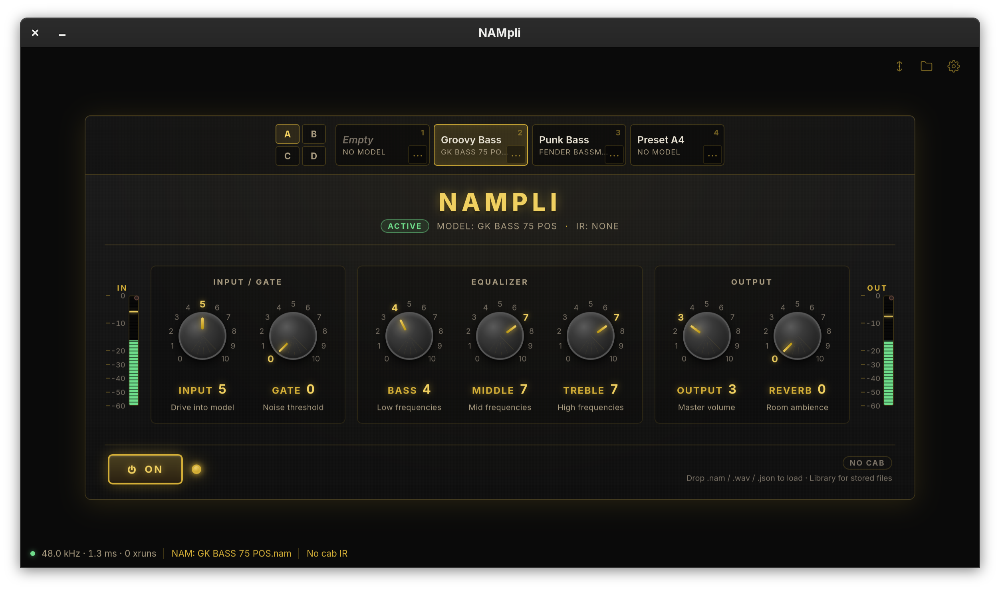

# NAMpli

A desktop amp for playing [Neural Amp Modeler](https://github.com/NeuralAmpModelerCore/NAM)
(NAM) guitar and bass captures through a cabinet impulse response (IR). Runs locally, offline,
with your audio interface — no plugin host or DAW needed.

*The faceplate: a 4×4 preset board, the amp knobs, IN/OUT level meters and the live audio status bar.
This shot has a NAM loaded and the amp powered on; no cabinet IR is loaded.*

## What is NAMpli?

A **NAM model** (`.nam` file) is a captured amp's sound. A **cab IR** (`.wav` file) is the
recorded response of a speaker cabinet — it turns the raw amp sound into something that feels like
a mic'd cab. NAMpli loads both, adds an output EQ, a room reverb and a noise gate, and plays the
result through your audio interface with low latency.

A few words you'll see throughout:

| Term | Meaning |
| --- | --- |
| **Bank / slot** | One of four banks (A–D) with four slots each: 16 places for presets. |
| **Preset** | A stored rig: name, all seven knob positions, and a NAM model and/or cab IR. |
| **Audition** | Try a preset or file temporarily. **Keep** accepts it; **Revert** puts your old sound back. |
| **Bypass** | Amp powered on with no model or IR loaded. The app starts this way. |

## What you need

- An audio interface (or other input/output device) with your guitar or bass plugged in, plus
  headphones or studio monitors.
- At least one NAM capture (`.nam`). Community captures are available from the
  [NAM project](https://github.com/NeuralAmpModelerCore/NAM) and capture libraries.
  A cabinet IR (`.wav`) is optional but recommended for a realistic guitar tone.
- NAMpli is currently built from source — see [Development](#development).
- On Linux, NAMpli is built with JACK support; other available hosts (such as ALSA or PulseAudio)
  can also be selected in Settings. You'll need JACK development headers installed (see
  [Development](#development)).

## The faceplate

| Control | What it does |
| --- | --- |
| **Input** (0–10) | Drive into the model. |
| **Gate** (0–10) | Noise threshold; higher values mute more between notes. |
| **Bass / Middle / Treble** (0–10) | Output EQ. |
| **Output** (0–10) | Master volume. |
| **Reverb** (0–10) | Algorithmic room ambience: 0 = off, 10 = maximum wet mix. Starts off, is saved with each preset, and needs no IR file. Older presets recall with it off. |
| **ON / standby** | Powers the audio path. In standby the meters idle and the status bar reads "Standby". |
| **IN / OUT meters** | Read-only dBFS meters: IN taps the raw input *before* trim, gate and model (good for checking a clipped input); OUT shows the final, limited signal. Both show RMS/peak values, a decaying peak marker and a clip indicator. They don't affect the sound or latency. |
| **Status bar** | Shows sample rate, latency and xruns while playing, plus the loaded NAM and cabinet names. |

The three tool buttons at the top right open the tuner, the Model & IR Library and Settings.

## Working with presets

- **Click a slot** to audition its knobs, NAM model and IR immediately. An empty slot auditions
  bypass (clears the model and IR but keeps knob positions) and becomes the target for **Save here**.
- **Keys `1`–`4`** audition the matching slot in the bank currently on screen; an empty slot selects
  bypass as the Save target.
- **Audition is safe.** A banner shows what you're previewing. `Esc` or **Revert** restores the
  exact sound you had before — including the previously loaded model and IR — and `Enter` or
  **Keep** accepts the preview. Starting another audition doesn't lose your original sound.
- **Knob changes are saved automatically** to the active preset after a short pause; there is no
  Save button. A gold dot marks unsaved edits and disappears once the write completes. Use
  **Save here** or **Save As…** in a slot's menu to write the current sound to a different slot.
- **Right-click a slot** (or its `⋯` button) for Import preset…, Save here, Save As…, Edit…,
  Export…, Rename… and Delete. **Edit…** opens a full-rig editor (name, all seven knobs and the
  model/IR) with a picker for already-imported files and an option to import new ones. Opening
  Edit… auditions the stored preset; changes play live, Cancel restores the previous sound, and
  Save writes the rig back to the same slot.
- Dropping a preset `.json` anywhere in the window imports it. Presets keep their model and cabinet
  after a restart; presets saved without either recall as bypass.

## Model & IR Library

The book icon opens a full-window browser for stored `.nam` and `.wav` files. Search by filename or
by the presets using it, filter by Models / IRs, and sort by name, kind, size, date or usage. Each
row shows file size, when it was added and how many presets use it; the details panel lists those
presets.

- **Import…** stores a copy of a `.nam` or `.wav` file without changing the live sound. Files are
  deduplicated by content hash, so importing the same file twice doesn't waste disk space.
- **Load** changes the live model or IR immediately. **Preview** (double-click, or `Enter` on a
  selected row) auditions it with the same Keep / Revert banner as preset auditions.
- **Export…** saves the original bytes to a path you choose. **Rename** changes the display name,
  updates every preset that referenced it, and reloads it if it is currently loaded. **Delete**
  removes the file after confirmation if presets use it, clearing those references.
- **Clean up…** removes files no preset uses. Files loaded in the rig are always kept, and the
  confirmation lists what would be deleted.
- `↑`/`↓` navigate rows, `Ctrl/Cmd+F` focuses search, and `Esc` or **← Back to amp** returns to the
  faceplate (`Esc` first reverts an active preview).

Dropped `.nam` and `.wav` files are imported and loaded immediately from any view, and the Library
refreshes to show them.

## Where your files live

Everything is stored locally in NAMpli's application data directory (`com.nampli.app`):

| Platform | Application data directory |
| --- | --- |
| Linux | `~/.local/share/com.nampli.app` (or `$XDG_DATA_HOME/com.nampli.app`) |
| macOS | `~/Library/Application Support/com.nampli.app` |
| Windows | `%APPDATA%\com.nampli.app` |

- `presets/index.json` lists the 4×4 grid; each preset is a separate `.json` file in `presets/`.
- `library/nam/` and `library/ir/` hold the imported model and cabinet files, each in a folder
  named after its content hash.
- To back up your rig, copy the whole application data directory. Audio device and buffer-size
  settings are global, not stored in presets.

## Troubleshooting / FAQ

- **No sound / status says "Standby".** Turn the amp on with the **ON** switch, then load a model or
  recall a preset — the app starts in bypass. Check that Output isn't at 0.
- **No devices listed.** Open Settings and try a different **Audio Host** (for example JACK vs.
  ALSA/PipeWire), then reselect input and output devices.
- **Clicks, crackles or xruns** (shown in the status bar). Increase **Latency** in Settings (e.g.
  512 or 1024 samples), and close other audio-hungry apps.
- **Notes cut out or the amp is silent but the tuner works.** The tuner listens before the gate.
  Lower the **Gate** knob, or raise your input level while watching the **IN** meter.
- **A preset lost its model or cabinet.** Re-import the file (dropping it loads it immediately) or
  check that the original is still in the Library; deleting a file clears references from presets.
- **I tried a preset and want my sound back.** Press `Esc` or click **Revert** in the audition
  banner before accepting it.

## Credits & License

Built with [Tauri](https://tauri.app/), React, Vite, cpal and the
[Neural Amp Modeler](https://github.com/NeuralAmpModelerCore/NAM) DSP. No license has been declared
in this repository yet.
