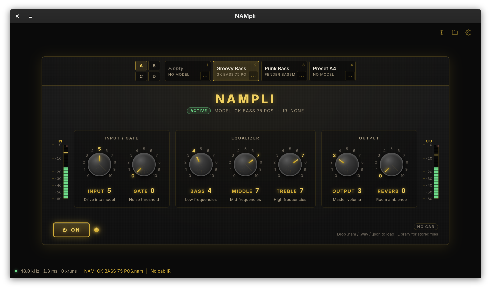

# NAMpli v0.1.0 — Release Notes

**Released:** November 25, 2026 · **License:** GPL-3.0-only · **Platforms:** Linux, Windows (build from source)



NAMpli is a desktop amp for playing [Neural Amp Modeler](https://github.com/NeuralAmpModelerCore/NAM)
guitar and bass captures through a cabinet impulse response (IR). It runs locally, offline, with
your audio interface — no plugin host or DAW required. This is NAMpli's first release.

## Highlights

- **Real-time amp modelling** with NAM captures, cabinet IRs, input/gate, three-band EQ, master
  volume and a room reverb knob, processed on a dedicated DSP thread with low-latency audio I/O.
- **4×4 preset board** (banks A–D) with safe audition and revert, automatic knob saving, and a
  full-rig editor.
- **Model & IR Library** for managing every stored `.nam` and `.wav` file, with usage tracking
  across presets.
- **Full-window chromatic tuner** and always-on **IN/OUT level meters** for gain staging.
- **GPL-3.0-only** licensed, with a new icon set and branding.

## What's new

### Amp and audio engine

- Live NAM model and IR loading by drag-and-drop or from the Library; the app starts in bypass.
- Seven front-panel knobs: Input, Gate, Bass, Middle, Treble, Output and Reverb (0 = off).
  Knob changes take effect immediately while playing.
- **De-clicking:** a short, nested output mute ramp hides the discontinuity when swapping the NAM,
  the IR or going to/from bypass, including during preset recalls.
- **IN/OUT meters:** vertical, log-scaled dBFS meters with RMS/peak readouts, decaying peak-hold
  markers and clip indicators. `IN` taps the raw input before trim, gate and model; `OUT` shows the
  final, limited signal. Both are read-only and add no audio latency.
- Status bar with sample rate, latency, xruns and the loaded NAM/cabinet names.

### Presets

- 16 slots across four banks: click a slot (or press `1`–`4`) to audition its knobs, NAM and IR.
  `Enter`/**Keep** accepts the preview; `Esc`/**Revert** restores the exact previous sound.
- Knob edits are saved automatically to the active preset after a short pause; a gold dot marks
  edits that have not been written yet.
- Slot menu with **New preset…**, **Edit…**, Rename… and Delete.
  **Edit…** opens a full-rig editor (name, all knobs, NAM/IR) with a picker of imported files;
  changes play live, Cancel restores the old sound and Save writes the rig back to the slot.
- Presets and their referenced files survive restarts. Dropping a preset `.json` anywhere in the
  window imports it.

### Model & IR Library

- Full-window browser opened from the book icon in the top-right tools. Search by file or preset
  name, filter by Models/IRs, and sort by name, kind, size, date or usage.
- Import stores a deduplicated copy without touching the live sound. Load changes the live rig
  immediately; Preview (double-click or `Enter`) uses the same Keep/Revert banner as presets.
- Export saves the original bytes; Rename updates every preset that referenced the file; Delete
  asks for confirmation when files are in use; Clean up removes unused files while keeping those
  loaded in the rig.
- Keyboard: `↑`/`↓` navigate, `Ctrl/Cmd+F` focuses search, `Esc` or **← Back to amp** returns.

### Tuner

- Full-window chromatic tuner with a large note display, ±50-cent scale, detected frequency and a
  raw input level bar. It reads the signal before the trim, gate and amp model, so quiet pickups
  are still tracked with the gate closed; readings are held briefly between plucks.
- Reference pitch defaults to A4 = 440 Hz and can be adjusted with the `−`/`+` controls (note naming
  only — detection and sound are unchanged).

### Interface and packaging

- Shared overlay/card/button primitives, a single stacking-token scale, keyboard-accessible menus
  and dialogs with focus trapping/restoration, and consistent `STANDBY / BYPASS / ACTIVE / PREVIEW`
  state labels across views.
- Floating tools appear only on the amp faceplate, so full-window views have unobstructed headers
  and footers that clear the status bar.
- New PNG/favicon/app icons, GPL-3.0 `LICENSE`, and `make appimage` / `make windows` build targets.

## Known limitations

- There are no bundled NAM captures or IRs: you need at least one `.nam` file and an audio
  interface to hear the amp. Cabinet IRs are optional.
- Builds are currently produced from source. Linux builds use JACK and require its development
  headers; `make windows` cross-compiles a portable `.exe` from Linux (installers require a Windows
  host). macOS is not officially supported yet.
- Audio device and buffer-size settings are global and are not stored in presets.
- The tuner is monophonic — it tracks a single note at a time.

## Build and install

```sh
make install      # npm install
make dev          # Tauri dev build with Vite HMR and JACK
make tauri-build  # release bundle
make appimage     # Linux AppImage only
make windows      # portable Windows .exe (requires mingw-w64)
```

`make` with no target runs install, Rust checks and the frontend build. See the
[README](README.md) for device setup, a first-session walkthrough and troubleshooting.

## Credits

Built with [Tauri](https://tauri.app/), React, Vite, cpal and the
[Neural Amp Modeler](https://github.com/NeuralAmpModelerCore/NAM) DSP. Released under the
[GNU GPL version 3](LICENSE) (GPL-3.0-only).
